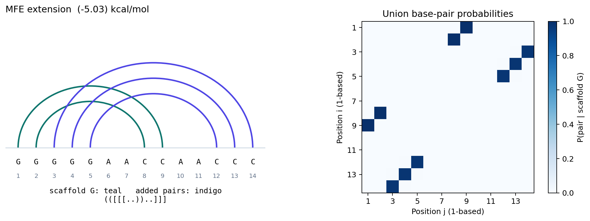
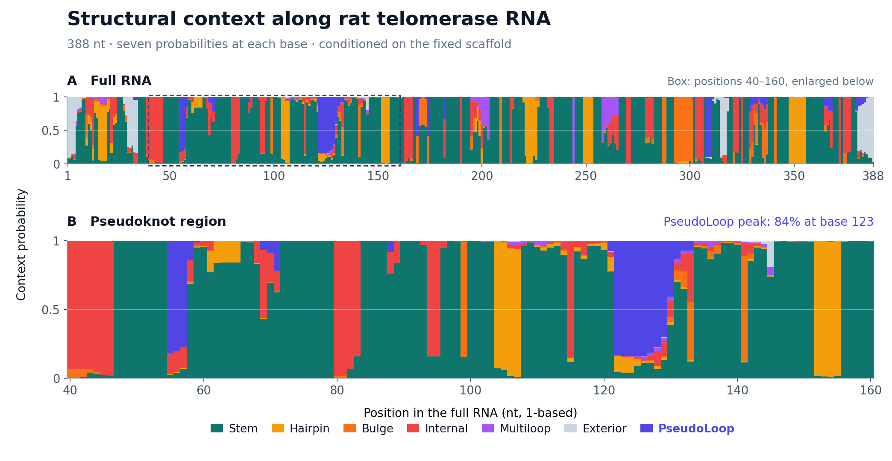
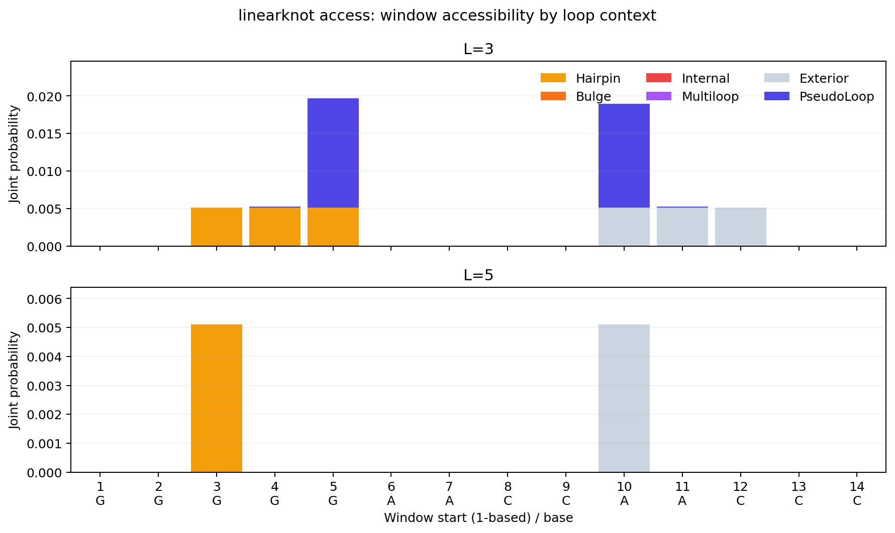

# LinearKnot

A beam-based toolkit for scaffold-constrained RNA pseudoknot folding and
ensemble analysis.

LinearKnot takes an RNA sequence and a noncrossing secondary-structure
scaffold whose base pairs stay fixed. It predicts additional pairs that
can cross the scaffold and computes ensemble properties in the density-2
hierarchical folding model. Beam approximation limits the candidates
retained during folding to make these analyses more tractable; exact
computation is also available for a supplied scaffold.

The toolset provides minimum-energy structures, base-pair probabilities,
structural profiles, accessibility, sampling, ranked suboptimal structures,
and MEA/centroid predictions through one command: `linearknot`.

Use **LinearKnot** for the project name and **linearknot** for the command
and package name. **Do not abbreviate the name to LinKnot or linknot.**

## Install

On Linux or macOS, the pip installation requires Python >=3.9,
a C compiler, and a C++17 compiler. From the repository root, install
the command in a Python virtual environment:

```bash
python3 -m venv .venv
source .venv/bin/activate
python -m pip install .
linearknot --help
```

Keep the environment active for the examples below. The Python distribution
installs the native CLI; the folding library's public API is C++.
ViennaRNA energy parameters are bundled, so no separate ViennaRNA
installation is required. Before a PyPI release, install from a checkout
as shown here.

If you use uv, `uv tool install .` installs the command in an isolated
tool environment. See [Python installation](python/README.md) for `uv add`
and wheel installation.

Alternatively, build with CMake >=3.15 and run the binary directly:

```bash
cmake -S . -B build -DCMAKE_BUILD_TYPE=Release -DBUILD_TESTING=OFF
cmake --build build -j8
./build/linearknot --help
```

With this build, use `./build/linearknot` in place of `linearknot` below.
To install it, run `cmake --install build --prefix /path/to/install` and
add `/path/to/install/bin` to PATH.

## Quick start

```bash
linearknot fold --sequence GGGGGAACCAACCC --scaffold '((.....)).....' --bpp bpp.tsv
```

The command prints:

```text
>seq1
GGGGGAACCAACCC
((.....)).....
(([[[..))..]]] (-5.03)
ensemble free energy: -5.0525 kcal/mol
```

The `()` pairs are the fixed scaffold. Three added `[]` pairs connect
the hairpin to the exterior and form a pseudoknot. The energy following
the predicted structure is its folding energy in kcal/mol; the last line
summarizes the ensemble. `bpp.tsv` contains base-pair probabilities,
including scaffold pairs with probability one.



## Input and scaffold

A scaffold specifies the base pairs to hold fixed. It can come from a
prior secondary-structure prediction or known base pairs. Supply a
scaffold of the same length as the sequence, using balanced round brackets
`()` and dots. Positions marked `.` may acquire additional pairs.
The CLI uses the supplied scaffold; scaffold selection is a separate step.

For file input, each record has an optional `>name` line, followed by one
sequence line and one scaffold line:

```text
>hairpin_exterior
GGGGGAACCAACCC
((.....)).....
```

```bash
linearknot fold -i examples/hairpin_exterior/input.txt --bpp bpp.tsv
```

A file can contain multiple records. Output structures include the
scaffold and added pairs, using additional bracket types to represent
crossings.

An **all-dot scaffold** is accepted and gives pseudoknot-free folding.
Crossing extensions require fixed scaffold pairs. All probabilities and
sampled structures are conditional on the supplied scaffold.

## Tools and outputs

| Task | Command | Output |
| --- | --- | --- |
| Predict a structure and pair probabilities | `linearknot fold` | Minimum-energy structure and ensemble free energy; `--bpp FILE` writes pair probabilities |
| Examine each base's structural context | `linearknot profile` | Loop and stem probabilities, including PseudoLoop |
| Find accessible sequence windows | `linearknot access` | Opening energies; `--probability` selects joint unpaired probabilities; `--by-loop` adds loop contributions |
| Draw structures from the ensemble | `linearknot sample` | Boltzmann samples; optionally group identical structures with counts |
| Enumerate low-energy structures | `linearknot subopt` | Up to K structures in nondecreasing energy order |
| Predict by maximum expected accuracy | `linearknot mea` | One MEA structure |
| Predict by gamma-centroid gain | `linearknot centroid` | One gamma-centroid structure |

Use `linearknot --help` to list commands and `linearknot COMMAND --help`
for each command's options. Energies are in kcal/mol, and BPP positions
are one-based.

## Loop profiles

`profile` describes the structural environment of each base across the
ensemble. This example uses rat telomerase RNA (Terc, 388 nt), with 61 fixed
scaffold pairs:

```bash
linearknot profile -i examples/terc_profile/input.txt \
  --beam 200 --max-hairpin 200 --max-case3-depth 200 > loop_profile.txt
```

The output has seven labeled rows: Stem, Hairpin, Bulge, Internal,
Multiloop, Exterior, and PseudoLoop, with one probability per sequence
position. The seven probabilities sum to one at each base. PseudoLoop
captures unpaired gaps between crossing bands. Multiloop includes the wings
of multiloops within a band, even when scored with pseudoknot parameters
([definition change in 0.2.0](documents/pseudoloop_context_change.md)).
Stem includes both scaffold pairs and added pairs.



The upper panel shows the full RNA; the lower panel enlarges positions
40–160 from the same calculation. PseudoLoop probability reaches about
84% at base 123 in this region.

See the [saved loop profile](examples/terc_profile/output/loop_profile.txt)
and [input provenance and reproduction steps](examples/terc_profile/README.md).

## Window accessibility

`access` computes the joint probability that an entire sequence window
is unpaired. This accounts for correlations between bases, rather than
multiplying their individual unpaired probabilities.

```bash
linearknot access -i examples/hairpin_exterior/input.txt --access-len 1,3,5 --probability > access.txt
linearknot access -i examples/hairpin_exterior/input.txt --access-len 1,3,5 --probability --by-loop > access_byloop.txt
```

Without `--probability`, the output is the window opening energy
`ED = -RT log P` in kcal/mol. `--by-loop` also splits accessibility into
Exterior, Hairpin, Bulge, Internal, Multi, and PseudoLoop contributions.
These contributions sum to the joint unpaired probability and remain
probabilities when the total column is an opening energy.



Raw window starts are **zero-based**; the figures use one-based positions.
See the [output format and saved tables](examples/README.md#window-accessibility-linearknot-access).

## Ensemble sampling

`sample` draws structures according to their Boltzmann probabilities, so
more probable structures tend to appear more often. Each output structure
contains the fixed scaffold and any sampled additional pairs.

```bash
linearknot sample -i examples/hairpin_exterior/input.txt --count 20 --seed 42 > samples.txt
linearknot sample -i examples/hairpin_exterior/input.txt --count 1000 --seed 42 --unique > sample_counts.txt
```

Ordinary output contains one structure per draw, including repeats.
`--unique` groups the requested draws into `count<TAB>structure` rows,
most frequent first; it does not request that many distinct structures.
Use `--seed` to repeat a run with the same settings. Counts divided by
the number of draws give empirical structure frequencies.

The [saved samples and counts](examples/README.md#ensemble-sampling-linearknot-sample)
show both formats. Sampling uses the retained ensemble in beam mode;
add `--exact` to sample from the full fixed-scaffold model.

## Ranked and representative structures

Use `subopt` to obtain up to K distinct structures in nondecreasing energy
order. These are ranked predictions, whereas sampling can return repeats
and does not sort by energy.

```bash
linearknot subopt -i examples/hairpin_exterior/input.txt --top-k 8 > subopt.txt
```

`mea` and `centroid` each produce a single representative structure using
ensemble base-pair probabilities. `--gamma` controls the reward for
predicting pairs under the chosen objective.

```bash
linearknot mea -i examples/hairpin_exterior/input.txt --gamma 1 > mea.txt
linearknot centroid -i examples/hairpin_exterior/input.txt --gamma 1 > centroid.txt
```

See the [saved MEA and centroid predictions](examples/README.md#representative-structures-linearknot-mea-and-centroid).

## Approximate and exact modes

The default beam size is 100 with outer ranking. A larger beam retains
more candidates and usually takes more time and memory. Finite-beam calls
also limit hairpin length and scaffold-ancestor exploration through
`--max-hairpin` and `--max-case3-depth` (both default to 30). Increasing the
beam width alone leaves these local limits in place.

Compare a larger beam with exact computation, which removes beam pruning
and the beam-only local limits:

```bash
linearknot fold -i examples/hairpin_exterior/input.txt --beam 200
linearknot fold -i examples/hairpin_exterior/input.txt --exact
linearknot subopt -i examples/hairpin_exterior/input.txt --exact --top-k 8
```

Exact computation is within the density-2 hierarchical model for the
**supplied scaffold**, which remains fixed. Beam results approximate that
ensemble. In beam mode, sampling and Subopt use the retained ensemble;
in exact mode they use the full fixed-scaffold model.

See [ranking and local limits](src/scfg2/api/README.md#outer-and-baseline-ranking)
for advanced settings. The [complexity documentation](documents/README.md)
records resource bounds and their assumptions for each operation.

## Documentation and help

| Looking for | Start here |
| --- | --- |
| Inputs, saved outputs, and reproducible PNG/SVG figures | [Example gallery](examples/README.md), covering all seven commands |
| pip, uv, and wheel installation | [Python installation](python/README.md) |
| Folding from a C++ program | [C++ API](src/scfg2/api/README.md) |
| Development, kernel structure, and validation | [Developer overview](src/scfg2/README.md) and [test guide](test/tools/README.md) |
| Model details, complexity bounds, and technical notes | [Documents guide](documents/README.md) |

The maintained implementation is under `src/scfg2/`. The documents guide
identifies current reference material and historical notes.

For questions or bug reports, use [GitHub Issues](https://github.com/TakumiOtagaki/LinearKnot/issues).
Include the output of `linearknot --version`, the command you ran, a small
sequence/scaffold input, and the expected and observed output.

## Citation and license

This tool builds on CParty:

Mateo Gray, Luke Trinity, Ulrike Stege, Yann Ponty, Sebastian Will, and
Hosna Jabbari. “CParty: hierarchically constrained partition function of
RNA pseudoknots.” *Bioinformatics* 41(1), btae748 (2025).
[doi:10.1093/bioinformatics/btae748](https://doi.org/10.1093/bioinformatics/btae748)

See [LICENSE](LICENSE) and [third-party notices](THIRD_PARTY_NOTICES.md)
for the project's GPLv3 license and the bundled ViennaRNA terms.
