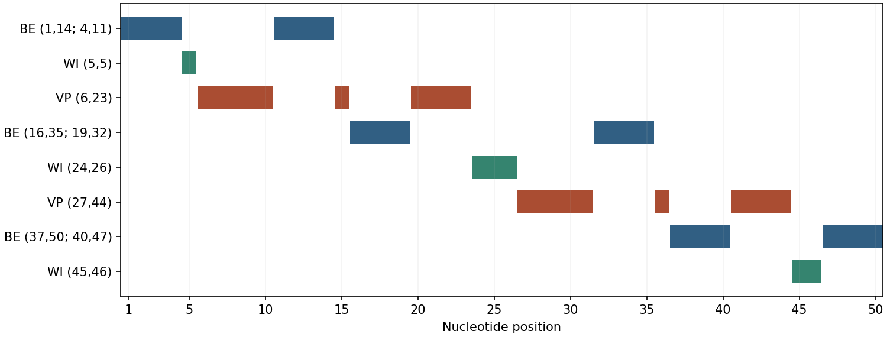

# LinearKnot の分配関数を読む

[教科書の章・図・記号と教材の対応表](textbook-guide.md)では、20塩基の弧図と $\alpha$・$\beta$ の定義から読み始められます。

基礎編の第00章 p05–06 では入力 $x=2$、途中の値 $u=x+1$、出力 $v=4u$ を定義します。順方向は $x\to u\to v$、微分は $v\to u\to x$ の順に、矢印と頂点の値を追えます。

YouTube アニメーション版　[① inside・outside の基礎](https://youtu.be/kzB3MKkpCCY) ／ [② 弧から読む非終端記号](https://youtu.be/aCoyDjjKfnU) ／ [③ 擬似ノット文法の演習](https://youtu.be/R8-eqW7GcNQ)

**[inside・outside を基礎から通して見る（33分50秒、日本語字幕付き MP4）](media/complete.mp4)** ｜ [通しの字幕](media/complete.srt) ｜ [基礎編だけ見る](media/chapter-00.mp4)

| 続けて見る講義 | 時間 | 字幕・テキスト |
|---|---:|---|
| [非終端記号編　塩基対の弧と木から15種類の状態を読む](media/nonterminals.mp4) | 10分56秒 | [字幕](media/nonterminals.srt)・[原稿](nonterminals-transcript.md)・[全57規則の数式](nonterminals.md) |
| [擬似ノット演習編　腕の配置から規則を選ぶ](media/pk-workshop.mp4) | 11分20秒 | [字幕](media/pk-workshop.srt)・[数式つき原稿](pk-workshop-transcript.md)・[導出木の図譜](derivations/README.md) |

GitHub のファイル画面で「View raw」またはダウンロードを選ぶと動画を開けます。章選択に対応するプレーヤーでは目次から途中の章へ移動できます。

[初めての方向けの用語・記号ガイド](first-words.md)では、塩基対・重み・確率と、式に使う印を小さな例で確認できます。

**数式から読みたい方は、[手計算・計算図・BE をつなぐ数式編](equations.md)から始められます。**
配列上で点を結んで描いた**塩基対**から始め、構造の重みを足す順方向計算と、個々の対がどれだけその和に寄与するかを求める逆方向計算を学ぶ教材です。

1. [文法編](grammar.md)では、固定する対を決めてから、どの部分を同時に組み合わせ、どの選択肢の間で和を取るかを追います。
2. [inside と outside 編](inside-outside.md)では、重みの総和を実際に微分し、部分構造が使われる平均回数と塩基対確率を求めます。
3. 下の例では、その微分を、2本の腕と中央の穴を持つ本物の文法規則に当てはめます。[動画の読み原稿](transcript.md)も章ごとに読めます。

[非終端記号編](nonterminals.md)には、15種類の状態を座標例・規則・子の積で定義し、擬似ノットを組み立てる練習問題と解答を載せています。[非終端記号編の読み原稿](nonterminals-transcript.md)もあります。

**[導出木の図譜（16例）](derivations/README.md)** では、座標と規則名を拡大して読める図と、親が選ぶ規則・子の座標を対応づけた表を用意しました。固定対を横切る対の左右に何があるかで変わる VP の9例を見比べられます。

## 動画を読む・聴く

基礎編の結合版には下表の第00～09章と第13章を収録しました。第10～12章も下表から個別に視聴できます。音声は VOICEVOX:ずんだもん。第0章で関数・微分・自動微分から inside/outside までを導入し、第1～5章で全体像をつかみ、第6章からは数値を代入して各式を展開します。

| 章 | 動画 | 時間 | 字幕 |
|---|---|---:|---|
| 00 | [基礎編　関数と微分から inside・outside へ](media/chapter-00.mp4) | 7:04 | [SRT](media/chapter-00.srt) |
| 01 | [構造を数える](media/chapter-01.mp4) | 1:36 | [SRT](media/chapter-01.srt) |
| 02 | [内側から分配関数を作る](media/chapter-02.mp4) | 1:30 | [SRT](media/chapter-02.srt) |
| 03 | [外側は逆向きの微分](media/chapter-03.mp4) | 1:32 | [SRT](media/chapter-03.srt) |
| 04 | [歯抜けの区間でも計算できる理由](media/chapter-04.mp4) | 3:18 | [SRT](media/chapter-04.srt) |
| 05 | [実例でたどる、3つの子を持つ規則](media/chapter-05.mp4) | 1:34 | [SRT](media/chapter-05.srt) |
| 06 | [path をたどって forward・backward を試す](media/chapter-06.mp4) | 3:56 | [SRT](media/chapter-06.srt) |
| 07 | [1つの規則の確率を全列挙で検算する](media/chapter-07.mp4) | 4:03 | [SRT](media/chapter-07.srt) |
| 08 | [紙と鉛筆で追う逆向きの微分](media/chapter-08.mp4) | 2:34 | [SRT](media/chapter-08.srt) |
| 09 | [塩基対に印をつけて確率を取り出す](media/chapter-09.mp4) | 3:04 | [SRT](media/chapter-09.srt) |
| 10 | [通常の枝を組み立てる](media/chapter-10.mp4) | 3:53 | [SRT](media/chapter-10.srt) |
| 11 | [50塩基の鎖を完成させる](media/chapter-11.mp4) | 3:53 | [SRT](media/chapter-11.srt) |
| 12 | [1つの構造を何回数えたか](media/chapter-12.mp4) | 4:03 | [SRT](media/chapter-12.srt) |
| 13 | [ビームで候補を落とした後の確率](media/chapter-13.mp4) | 3:40 | [SRT](media/chapter-13.srt) |

## 50 塩基の例で、同じ1行を前後に読む

位置は 1 から数えます。教科書の 50 塩基の導出（規則を選んで構造を作る手順）の冒頭には次の結合があります。左側が親、右側が同時に使う3つの子です。

```text
WMBP(1,23) ← BE(1,14;4,11) × WI(5,5) × VP(6,23)
```

| 子 | この段階での役割 |
|---|---|
| BE | 固定した対 (1,14) から (4,11) までの2本の腕をたどる。腕の座標は 1～4 と 11～14。 |
| WI | 腕の横の隙間である 5 番を処理する。 |
| VP | 固定対と交差する (6,23) を扱う。途中の 11～14 は最初の BE が受け持つ。 |

下図は塩基の並びに沿った **BE の腕だけ**の目盛りです。同じ記号を上下にそろえた2つの位置が固定対の端です。

```text
位置       1  2  3  4 | 5  6  7  8  9 10 |11 12 13 14
固定対     A  B  C  D |                  | D  C  B  A
BE の腕    ●  ●  ●  ● |                  | ●  ●  ●  ●
WI の位置             | ●                |
VP の左端             |    ↑             |             → 右端は23
```

**16～19 番をこの3つに無理に割り当てないこと**が大切です。親 WMBP は構築の途中です。次に結合する BE(16,35;19,32) がその4つの位置を左腕として受け取ります。中央の穴に1つの独立した構造を自由に置ける、という仮定も必要ありません。どの相手と結合できるかは文法が決めます。



図は結合を最後まで進めたときの担当です。1つの列を縦に見ると色のついた行は1つだけです。例えば 15 番と 20 番はどちらも VP(6,23) の部分木に入り、その間の 16～19 番は別の BE に入ります。

各状態の内側の重みの和を α、結合の重みを w と書きます。この1行が親に足す値は w × α(BE) × α(WI) × α(VP) です。全体の分配関数を Z とすると、親の値を少し変えたときに Z が変わる倍率を β(WMBP) と書けます。BE の値を少し変えると、まず親が w × α(WI) × α(VP) 倍だけ応答し、その応答がさらに β(WMBP) 倍されて Z に届きます。これが、この1行から β(BE) に加える量です。腕の座標が2つに分かれていても、掛けた数とそれを使った場所は明確です。

**手計算**　仮に α(BE)=3、α(WI)=1、α(VP)=5、w=2、β(WMBP)=7 と置くと、順方向で親に足す値は 30、逆方向で BE に足す値は 70 です。BE の値だけを 0.01 増やせば、この経路を通る Z の変化は 0.7。これらは演算を追うための仮の数値です。座標と親子関係は教科書の保存例に基づきます。

元資料は同じ作業環境の `../LinearCPartyPaper/textbook/chapters/04_pk_block.tex` の 50 塩基の例です。実装の境界条件は[文法規則の解説](../../src/scfg2/deductions/README.md)で確認できます。

## 読後の確認問題

1. 2つの子の重みの和が 3 と 5。両者をつなぐ規則の重みは 2、親の outside は 7。値が 3 の子へいくら戻すか。
2. ある対を出す2つの規則から、全導出の中でそれぞれ 12 と 8 の重みが集まった。分配関数は 50 で、どの導出でもこの対を生成するのは1度まで。その対を含む確率はいくらか。
3. この例の BE の2つの腕を、1本の区間 1～14 として中央もすべて採点すると何が起こるか。
4. ある選択肢の重みが 3 と 2 のとき、前者だけを残して計算した場合、前者を選ぶ確率と、その値に関する微分はどの集団を表すか。

**答え**

1. 7 × 2 × 5 = 70。値を微分する子自身の 3 は掛けず、その兄弟の 5 を掛ける。
2. (12 + 8) / 50 = 0.4。2つの規則が同じ対を同じ導出で2度計上するなら、この足し方が返すのは出現回数の平均になる。
3. 例えば 5 番は既に WI の担当であり、6 番からは VP が処理する位置もある。中央を BE にも割り当てると、同じ位置を二重に処理したり、別の枝が作るはずの対を BE に要求して合法な構造を捨てたりする。
4. 全候補では 3/5、前者だけ残した場合は 3/3 = 1。残した規則を固定して逆向きに計算すれば、その規則集合で求めた分配関数の微分になる。候補の順位が変わって後者が復活する効果は、この計算の外にある。

字幕は校正した原稿から作り、発音は VOICEVOX の読みと日本語 Whisper-small による音声の文字起こしで点検しました。初回の照合で「値」「1/100」「1本鎖」「左腕」「1行」などを含む9発話に読みを指定し、冒頭5章の全36発話を確認しました。「塩基」を「演技」と書き起こすような音声認識側の誤変換もあるため、字幕には原稿の専門用語と表記を用いています。

弧図版では、旧版から音声が変わった32発話を Whisper small と合成時の音素列で再確認し、「弱閉区間」「塩基対」「値」などの読みを修正しました。
