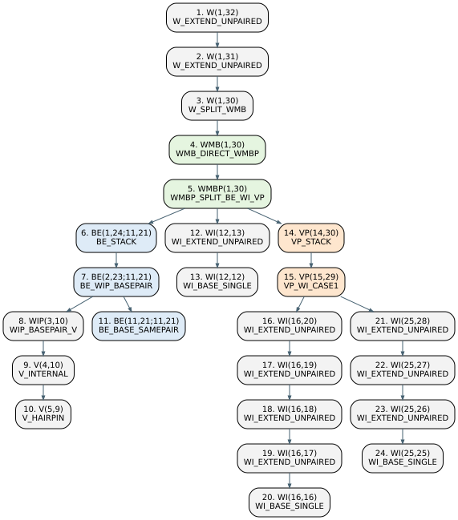

# 固定バンドの腕に別の枝を入れる

固定対を丸括弧、追加対を角括弧で示す。同じ種類の開き括弧と閉じ括弧を、内側から順に対応させて読む。入力で決まっている固定対は、結合時に再び選び直さない。

```text
配列　　GGAGGAAACCGAAGGAAAAACACCAAAACCAA
固定対　((.((...))(.........).))........
追加対　.............[[.............]]..
完成形　((.((...))(..[[.....).))....]]..
```



[図を単独で拡大](band_wip.svg)

| # | 状態 | 選んだ規則 | 子の番号（順序付き） |
|---:|---|---|---|
| 1 | `W(1,32)` | `W_EXTEND_UNPAIRED` | 2 |
| 2 | `W(1,31)` | `W_EXTEND_UNPAIRED` | 3 |
| 3 | `W(1,30)` | `W_SPLIT_WMB` | 4 |
| 4 | `WMB(1,30)` | `WMB_DIRECT_WMBP` | 5 |
| 5 | `WMBP(1,30)` | `WMBP_SPLIT_BE_WI_VP` | 6, 12, 14 |
| 6 | `BE(1,24;11,21)` | `BE_STACK` | 7 |
| 7 | `BE(2,23;11,21)` | `BE_WIP_BASEPAIR` | 8, 11 |
| 8 | `WIP(3,10)` | `WIP_BASEPAIR_V` | 9 |
| 9 | `V(4,10)` | `V_INTERNAL` | 10 |
| 10 | `V(5,9)` | `V_HAIRPIN` | ∅ |
| 11 | `BE(11,21;11,21)` | `BE_BASE_SAMEPAIR` | ∅ |
| 12 | `WI(12,13)` | `WI_EXTEND_UNPAIRED` | 13 |
| 13 | `WI(12,12)` | `WI_BASE_SINGLE` | ∅ |
| 14 | `VP(14,30)` | `VP_STACK` | 15 |
| 15 | `VP(15,29)` | `VP_WI_CASE1` | 16, 21 |
| 16 | `WI(16,20)` | `WI_EXTEND_UNPAIRED` | 17 |
| 17 | `WI(16,19)` | `WI_EXTEND_UNPAIRED` | 18 |
| 18 | `WI(16,18)` | `WI_EXTEND_UNPAIRED` | 19 |
| 19 | `WI(16,17)` | `WI_EXTEND_UNPAIRED` | 20 |
| 20 | `WI(16,16)` | `WI_BASE_SINGLE` | ∅ |
| 21 | `WI(25,28)` | `WI_EXTEND_UNPAIRED` | 22 |
| 22 | `WI(25,27)` | `WI_EXTEND_UNPAIRED` | 23 |
| 23 | `WI(25,26)` | `WI_EXTEND_UNPAIRED` | 24 |
| 24 | `WI(25,25)` | `WI_BASE_SINGLE` | ∅ |

教科書の対応する実行記録は `04_pk_block/v58a2b796/band_wip.txt`。

## この木を一つの項として評価する

木を $T$、頂点 $v$ で選んだ規則の局所重みを $w_v$ とする。同じ数値の因子をまとめ、重み 1 の因子を省くと、

$$
w(T)=\prod_{v\in T}w_v\simeq (9.38482)\,(0.000341263)\,(117.375)^{2}\,(0.000528868)\,(0.331767)\,(211.527)\,(0.000156623)\,(0.907237)^{11}\simeq 8.79016\times 10^{-5}.
$$

各因子は表示時に丸めた。根の inside は、この木も含めて、根から導出できるすべての木の重みを足した値である。
