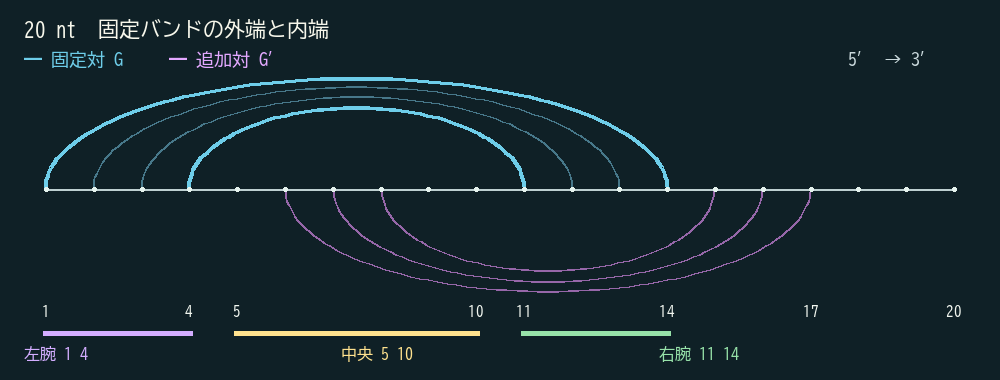
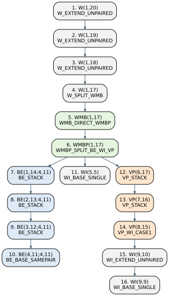

# 固定バンドの内側から右へ交差する

固定対を丸括弧、追加対を角括弧で示す。同じ種類の開き括弧と閉じ括弧を、内側から順に対応させて読む。入力で決まっている固定対は、結合時に再び選び直さない。

```text
配列　　GGGGAGGGAACCCCCCCAAA
固定対　((((......))))......
追加対　.....[[[......]]]...
完成形　((((.[[[..))))]]]...
```

## 配列上で対の両端を見る



上の青い弧は固定対 $G$、下の紫の弧は追加対 $G^\prime$ を表す。端の順が交互なら2対は交差する。

- 固定対　(1,14)、(2,13)、(3,12)、(4,11)
- 追加対　(6,17)、(7,16)、(8,15)

## この構造を作る導出



[図を単独で拡大](case1.svg)

| # | 状態 | 選んだ規則 | 子の番号（順序付き） |
|---:|---|---|---|
| 1 | `W(1,20)` | `W_EXTEND_UNPAIRED` | 2 |
| 2 | `W(1,19)` | `W_EXTEND_UNPAIRED` | 3 |
| 3 | `W(1,18)` | `W_EXTEND_UNPAIRED` | 4 |
| 4 | `W(1,17)` | `W_SPLIT_WMB` | 5 |
| 5 | `WMB(1,17)` | `WMB_DIRECT_WMBP` | 6 |
| 6 | `WMBP(1,17)` | `WMBP_SPLIT_BE_WI_VP` | 7, 11, 12 |
| 7 | `BE(1,14;4,11)` | `BE_STACK` | 8 |
| 8 | `BE(2,13;4,11)` | `BE_STACK` | 9 |
| 9 | `BE(3,12;4,11)` | `BE_STACK` | 10 |
| 10 | `BE(4,11;4,11)` | `BE_BASE_SAMEPAIR` | ∅ |
| 11 | `WI(5,5)` | `WI_BASE_SINGLE` | ∅ |
| 12 | `VP(6,17)` | `VP_STACK` | 13 |
| 13 | `VP(7,16)` | `VP_STACK` | 14 |
| 14 | `VP(8,15)` | `VP_WI_CASE1` | 15 |
| 15 | `WI(9,10)` | `WI_EXTEND_UNPAIRED` | 16 |
| 16 | `WI(9,9)` | `WI_BASE_SINGLE` | ∅ |

教科書の対応する実行記録は `04_pk_block/v58a2b796/case1.txt`。

## この木を1つの項として評価する

木を $T$、頂点 $v$ で選んだ規則の局所重みを $w_v$ とする。同じ数値の因子をまとめ、重み 1 の因子を省くと、

$$
w(T)=\prod_{v\in T}w_v\simeq (9.38482)\,(0.000341263)\,(117.375)^{5}\,(0.907237)^{3}\simeq 5.327939\times 10^{7}.
$$

各因子は表示時に丸めた。根の inside は、この木も含めて、根から導出できるすべての木の重みを足した値である。
