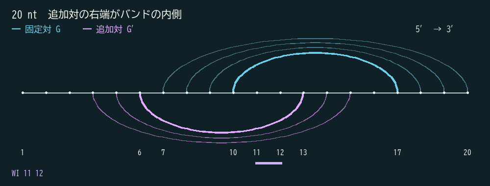
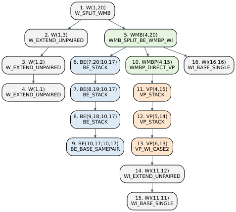

# 固定バンドの外側から内側へ交差する

固定対を丸括弧、追加対を角括弧で示す。同じ種類の開き括弧と閉じ括弧を、内側から順に対応させて読む。入力で決まっている固定対は、結合時に再び選び直さない。

```text
配列　　AAAGGGGGGGAACCCACCCC
固定対　......((((......))))
追加対　...[[[......]]].....
完成形　...[[[((((..]]].))))
```

## 配列上で対の両端を見る



上の青い弧は固定対 $G$、下の紫の弧は追加対 $G^\prime$ を表す。端の順が交互なら2対は交差する。

- 固定対　(7,20)、(8,19)、(9,18)、(10,17)
- 追加対　(4,15)、(5,14)、(6,13)

## この構造を作る導出



[図を単独で拡大](case2.svg)

| # | 状態 | 選んだ規則 | 子の番号（順序付き） |
|---:|---|---|---|
| 1 | `W(1,20)` | `W_SPLIT_WMB` | 2, 5 |
| 2 | `W(1,3)` | `W_EXTEND_UNPAIRED` | 3 |
| 3 | `W(1,2)` | `W_EXTEND_UNPAIRED` | 4 |
| 4 | `W(1,1)` | `W_EXTEND_UNPAIRED` | ∅ |
| 5 | `WMB(4,20)` | `WMB_SPLIT_BE_WMBP_WI` | 6, 10, 16 |
| 6 | `BE(7,20;10,17)` | `BE_STACK` | 7 |
| 7 | `BE(8,19;10,17)` | `BE_STACK` | 8 |
| 8 | `BE(9,18;10,17)` | `BE_STACK` | 9 |
| 9 | `BE(10,17;10,17)` | `BE_BASE_SAMEPAIR` | ∅ |
| 10 | `WMBP(4,15)` | `WMBP_DIRECT_VP` | 11 |
| 11 | `VP(4,15)` | `VP_STACK` | 12 |
| 12 | `VP(5,14)` | `VP_STACK` | 13 |
| 13 | `VP(6,13)` | `VP_WI_CASE2` | 14 |
| 14 | `WI(11,12)` | `WI_EXTEND_UNPAIRED` | 15 |
| 15 | `WI(11,11)` | `WI_BASE_SINGLE` | ∅ |
| 16 | `WI(16,16)` | `WI_BASE_SINGLE` | ∅ |

教科書の対応する実行記録は `04_pk_block/v58a2b796/case2.txt`。

## この木を1つの項として評価する

木を $T$、頂点 $v$ で選んだ規則の局所重みを $w_v$ とする。同じ数値の因子をまとめ、重み 1 の因子を省くと、

$$
w(T)=\prod_{v\in T}w_v\simeq (9.38482)\,(0.0184733)^{2}\,(117.375)^{5}\,(0.907237)^{3}\simeq 5.327939\times 10^{7}.
$$

各因子は表示時に丸めた。根の inside は、この木も含めて、根から導出できるすべての木の重みを足した値である。
