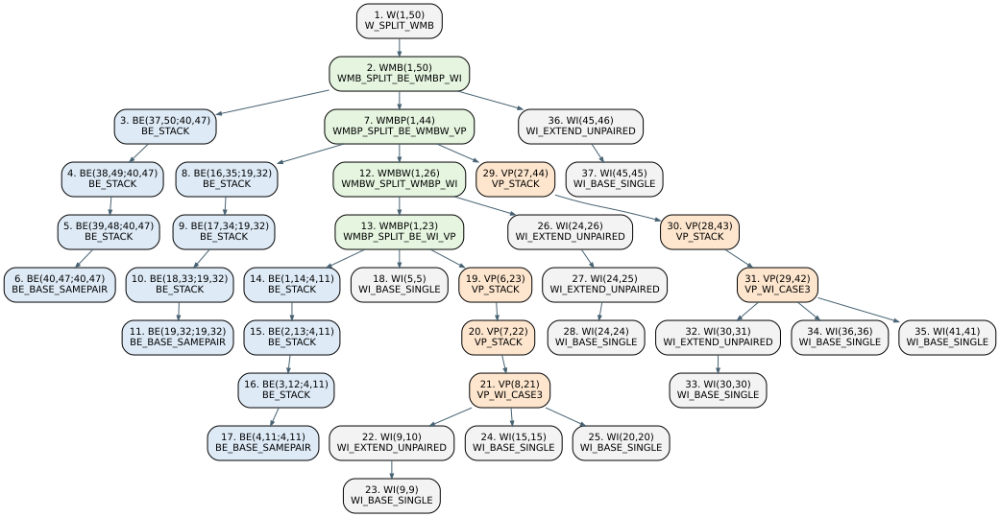

# 固定バンドを三本つなぐ

固定対を丸括弧、追加対を角括弧で示す。同じ種類の開き括弧と閉じ括弧を、内側から順に対応させて読む。入力で決まっている固定対は、結合時に再び選び直さない。

```text
配列　　GGGGAGGGAACCCCAGGGGACCCAAAGGGAACCCCAGGGGACCCAACCCC
固定対　((((......)))).((((............)))).((((......))))
追加対　.....[[[............]]]...[[[............]]]......
完成形　((((.[[[..)))).((((.]]]...[[[..)))).((((.]]]..))))
```



[図を単独で拡大](chain50.svg)

| # | 状態 | 選んだ規則 | 子の番号（順序付き） |
|---:|---|---|---|
| 1 | `W(1,50)` | `W_SPLIT_WMB` | 2 |
| 2 | `WMB(1,50)` | `WMB_SPLIT_BE_WMBP_WI` | 3, 7, 36 |
| 3 | `BE(37,50;40,47)` | `BE_STACK` | 4 |
| 4 | `BE(38,49;40,47)` | `BE_STACK` | 5 |
| 5 | `BE(39,48;40,47)` | `BE_STACK` | 6 |
| 6 | `BE(40,47;40,47)` | `BE_BASE_SAMEPAIR` | ∅ |
| 7 | `WMBP(1,44)` | `WMBP_SPLIT_BE_WMBW_VP` | 8, 12, 29 |
| 8 | `BE(16,35;19,32)` | `BE_STACK` | 9 |
| 9 | `BE(17,34;19,32)` | `BE_STACK` | 10 |
| 10 | `BE(18,33;19,32)` | `BE_STACK` | 11 |
| 11 | `BE(19,32;19,32)` | `BE_BASE_SAMEPAIR` | ∅ |
| 12 | `WMBW(1,26)` | `WMBW_SPLIT_WMBP_WI` | 13, 26 |
| 13 | `WMBP(1,23)` | `WMBP_SPLIT_BE_WI_VP` | 14, 18, 19 |
| 14 | `BE(1,14;4,11)` | `BE_STACK` | 15 |
| 15 | `BE(2,13;4,11)` | `BE_STACK` | 16 |
| 16 | `BE(3,12;4,11)` | `BE_STACK` | 17 |
| 17 | `BE(4,11;4,11)` | `BE_BASE_SAMEPAIR` | ∅ |
| 18 | `WI(5,5)` | `WI_BASE_SINGLE` | ∅ |
| 19 | `VP(6,23)` | `VP_STACK` | 20 |
| 20 | `VP(7,22)` | `VP_STACK` | 21 |
| 21 | `VP(8,21)` | `VP_WI_CASE3` | 22, 24, 25 |
| 22 | `WI(9,10)` | `WI_EXTEND_UNPAIRED` | 23 |
| 23 | `WI(9,9)` | `WI_BASE_SINGLE` | ∅ |
| 24 | `WI(15,15)` | `WI_BASE_SINGLE` | ∅ |
| 25 | `WI(20,20)` | `WI_BASE_SINGLE` | ∅ |
| 26 | `WI(24,26)` | `WI_EXTEND_UNPAIRED` | 27 |
| 27 | `WI(24,25)` | `WI_EXTEND_UNPAIRED` | 28 |
| 28 | `WI(24,24)` | `WI_BASE_SINGLE` | ∅ |
| 29 | `VP(27,44)` | `VP_STACK` | 30 |
| 30 | `VP(28,43)` | `VP_STACK` | 31 |
| 31 | `VP(29,42)` | `VP_WI_CASE3` | 32, 34, 35 |
| 32 | `WI(30,31)` | `WI_EXTEND_UNPAIRED` | 33 |
| 33 | `WI(30,30)` | `WI_BASE_SINGLE` | ∅ |
| 34 | `WI(36,36)` | `WI_BASE_SINGLE` | ∅ |
| 35 | `WI(41,41)` | `WI_BASE_SINGLE` | ∅ |
| 36 | `WI(45,46)` | `WI_EXTEND_UNPAIRED` | 37 |
| 37 | `WI(45,45)` | `WI_BASE_SINGLE` | ∅ |

教科書の対応する実行記録は `04_pk_block/v58a2b796/chain50.txt`。

## この木を一つの項として評価する

木を $T$、頂点 $v$ で選んだ規則の局所重みを $w_v$ とする。同じ数値の因子をまとめ、重み 1 の因子を省くと、

$$
w(T)=\prod_{v\in T}w_v\simeq (9.38482)\,(0.0184733)\,(117.375)^{13}\,(0.000341263)^{2}\,(0.907237)^{14}\simeq 4.146973e+18.
$$

各因子は表示時に丸めた。根の inside は、この木も含めて、根から導出できるすべての木の重みを足した値である。
