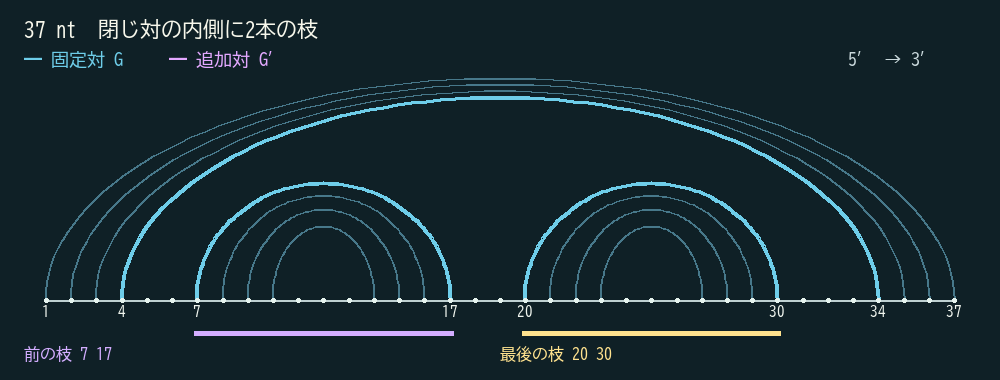
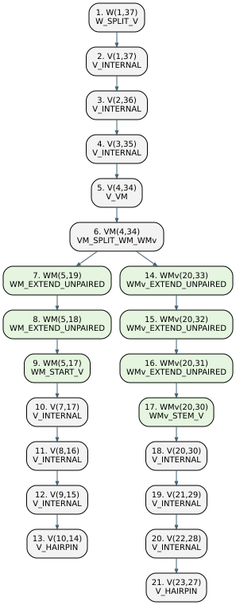

# 通常の多分岐を閉じる

固定対を丸括弧、追加対を角括弧で示す。同じ種類の開き括弧と閉じ括弧を、内側から順に対応させて読む。入力で決まっている固定対は、結合時に再び選び直さない。

```text
配列　　GGGGAAGGGGAAACCCCAAGGGGAAACCCCAAACCCC
固定対　((((..((((...))))..((((...))))...))))
追加対　.....................................
完成形　((((..((((...))))..((((...))))...))))
```

## 配列上で対の両端を見る



上の青い弧は固定対 $G$、下の紫の弧は追加対 $G^\prime$ を表す。端の順が交互なら二対は交差する。

- 固定対　(1,37)、(2,36)、(3,35)、(4,34)、(7,17)、(8,16)、(9,15)、(10,14)、(20,30)、(21,29)、(22,28)、(23,27)
- 追加対　なし

## この構造を作る導出



[図を単独で拡大](multiloop.svg)

| # | 状態 | 選んだ規則 | 子の番号（順序付き） |
|---:|---|---|---|
| 1 | `W(1,37)` | `W_SPLIT_V` | 2 |
| 2 | `V(1,37)` | `V_INTERNAL` | 3 |
| 3 | `V(2,36)` | `V_INTERNAL` | 4 |
| 4 | `V(3,35)` | `V_INTERNAL` | 5 |
| 5 | `V(4,34)` | `V_VM` | 6 |
| 6 | `VM(4,34)` | `VM_SPLIT_WM_WMv` | 7, 14 |
| 7 | `WM(5,19)` | `WM_EXTEND_UNPAIRED` | 8 |
| 8 | `WM(5,18)` | `WM_EXTEND_UNPAIRED` | 9 |
| 9 | `WM(5,17)` | `WM_START_V` | 10 |
| 10 | `V(7,17)` | `V_INTERNAL` | 11 |
| 11 | `V(8,16)` | `V_INTERNAL` | 12 |
| 12 | `V(9,15)` | `V_INTERNAL` | 13 |
| 13 | `V(10,14)` | `V_HAIRPIN` | ∅ |
| 14 | `WMv(20,33)` | `WMv_EXTEND_UNPAIRED` | 15 |
| 15 | `WMv(20,32)` | `WMv_EXTEND_UNPAIRED` | 16 |
| 16 | `WMv(20,31)` | `WMv_EXTEND_UNPAIRED` | 17 |
| 17 | `WMv(20,30)` | `WMv_STEM_V` | 18 |
| 18 | `V(20,30)` | `V_INTERNAL` | 19 |
| 19 | `V(21,29)` | `V_INTERNAL` | 20 |
| 20 | `V(22,28)` | `V_INTERNAL` | 21 |
| 21 | `V(23,27)` | `V_HAIRPIN` | ∅ |

教科書の対応する実行記録は `03_grammar/v58a2b796/multiloop.txt`。
