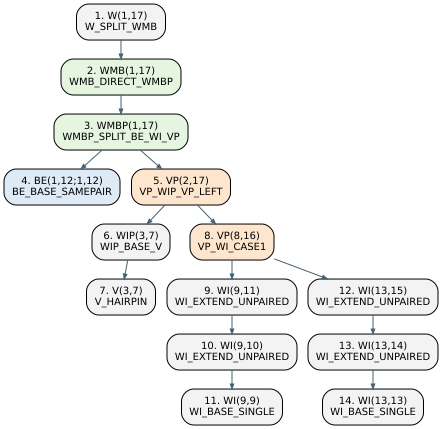

# VP の左右ポケット BE

固定対を丸括弧、追加対を角括弧で示す。同じ種類の開き括弧と閉じ括弧を、内側から順に対応させて読む。入力で決まっている固定対は、結合時に再び選び直さない。

```text
配列　　GGGAAACGAAACAAACC
固定対　(..........).....
追加対　.[[...][.......]]
完成形　([[...][...)...]]
```



[図を単独で拡大](vp_BE.svg)

| # | 状態 | 選んだ規則 | 子の番号（順序付き） |
|---:|---|---|---|
| 1 | `W(1,17)` | `W_SPLIT_WMB` | 2 |
| 2 | `WMB(1,17)` | `WMB_DIRECT_WMBP` | 3 |
| 3 | `WMBP(1,17)` | `WMBP_SPLIT_BE_WI_VP` | 4, 5 |
| 4 | `BE(1,12;1,12)` | `BE_BASE_SAMEPAIR` | ∅ |
| 5 | `VP(2,17)` | `VP_WIP_VP_LEFT` | 6, 8 |
| 6 | `WIP(3,7)` | `WIP_BASE_V` | 7 |
| 7 | `V(3,7)` | `V_HAIRPIN` | ∅ |
| 8 | `VP(8,16)` | `VP_WI_CASE1` | 9, 12 |
| 9 | `WI(9,11)` | `WI_EXTEND_UNPAIRED` | 10 |
| 10 | `WI(9,10)` | `WI_EXTEND_UNPAIRED` | 11 |
| 11 | `WI(9,9)` | `WI_BASE_SINGLE` | ∅ |
| 12 | `WI(13,15)` | `WI_EXTEND_UNPAIRED` | 13 |
| 13 | `WI(13,14)` | `WI_EXTEND_UNPAIRED` | 14 |
| 14 | `WI(13,13)` | `WI_BASE_SINGLE` | ∅ |

教科書の対応する実行記録は `03_grammar/v58a2b796/vp_BE.txt`。
