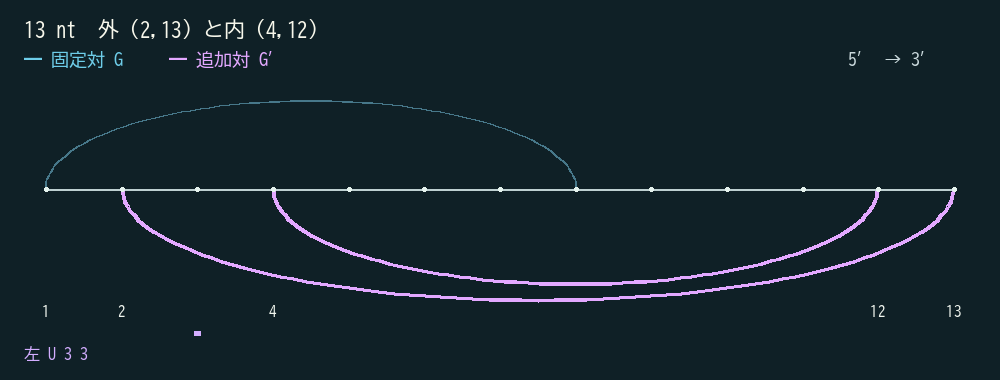
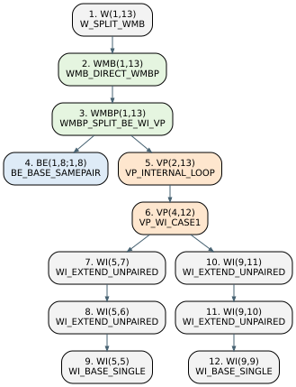

# VP の左右ポケット UE

固定対を丸括弧、追加対を角括弧で示す。同じ種類の開き括弧と閉じ括弧を、内側から順に対応させて読む。入力で決まっている固定対は、結合時に再び選び直さない。

```text
配列　　GGAGAAACAAACC
固定対　(......).....
追加対　.[.[.......]]
完成形　([.[...)...]]
```

## 配列上で対の両端を見る



上の青い弧は固定対 $G$、下の紫の弧は追加対 $G^\prime$ を表す。端の順が交互なら二対は交差する。

- 固定対　(1,8)
- 追加対　(2,13)、(4,12)

## この構造を作る導出



[図を単独で拡大](vp_UE.svg)

| # | 状態 | 選んだ規則 | 子の番号（順序付き） |
|---:|---|---|---|
| 1 | `W(1,13)` | `W_SPLIT_WMB` | 2 |
| 2 | `WMB(1,13)` | `WMB_DIRECT_WMBP` | 3 |
| 3 | `WMBP(1,13)` | `WMBP_SPLIT_BE_WI_VP` | 4, 5 |
| 4 | `BE(1,8;1,8)` | `BE_BASE_SAMEPAIR` | ∅ |
| 5 | `VP(2,13)` | `VP_INTERNAL_LOOP` | 6 |
| 6 | `VP(4,12)` | `VP_WI_CASE1` | 7, 10 |
| 7 | `WI(5,7)` | `WI_EXTEND_UNPAIRED` | 8 |
| 8 | `WI(5,6)` | `WI_EXTEND_UNPAIRED` | 9 |
| 9 | `WI(5,5)` | `WI_BASE_SINGLE` | ∅ |
| 10 | `WI(9,11)` | `WI_EXTEND_UNPAIRED` | 11 |
| 11 | `WI(9,10)` | `WI_EXTEND_UNPAIRED` | 12 |
| 12 | `WI(9,9)` | `WI_BASE_SINGLE` | ∅ |

教科書の対応する実行記録は `03_grammar/v58a2b796/vp_UE.txt`。
