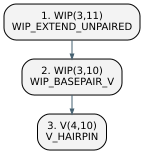

# 同じ枝を WIP で受け取る

固定対を丸括弧、追加対を角括弧で示す。同じ種類の開き括弧と閉じ括弧を、内側から順に対応させて読む。入力で決まっている固定対は、結合時に再び選び直さない。

```text
配列　　AAAGAAAAACA
固定対　...........
追加対　...[.....].
完成形　...[.....].
```



[図を単独で拡大](wip_same_branch.svg)

| # | 状態 | 選んだ規則 | 子の番号（順序付き） |
|---:|---|---|---|
| 1 | `WIP(3,11)` | `WIP_EXTEND_UNPAIRED` | 2 |
| 2 | `WIP(3,10)` | `WIP_BASEPAIR_V` | 3 |
| 3 | `V(4,10)` | `V_HAIRPIN` | ∅ |

教科書の対応する実行記録は `03_grammar/v58a2b796/wip_same_branch.txt`。
