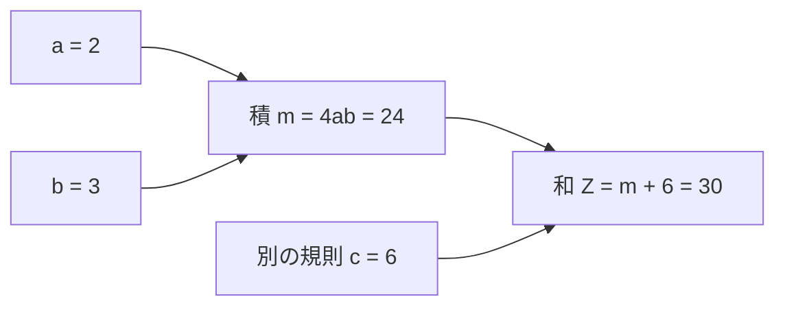

# 式でたどる inside・outside と BE

本教材の $\alpha$（inside）と $\beta$（outside）は実数の重みで表す。教科書の擬似コードに出る対数表との換算は[教科書と記号の対応](textbook-guide.md#実数の重みと教科書の-log-表)に示す。

最終目標は塩基対 $(i,j)$ の確率を求めることに置く。足場 $G$ は必ず含める対の集合、$x$ は塩基配列、$n$ はその長さとする。以下の確率はすべて $x,G$ を固定した条件付き確率である。最初に分配関数を組み立て、次にその式を微分し、最後に同じ手順を LinearKnot の結合規則に当てはめる。

## 冒頭の計算グラフで使う文字

入力を $x$ とする。入力に 1 を足した値を $u$、その値を 4 倍した最終出力を $v$ と名付ける。この定義は順方向と逆方向の両方で同じである。

$$
x=2\quad\longrightarrow\quad u=x+1=3
\quad\longrightarrow\quad v=4u=12.
$$

逆向きの各地点に書く数は「その地点の値を少し動かすと、出力 $v$ が何倍変わるか」である。まず $dv/dv=1$。$v$ を作った掛け算を戻ると $dv/du=4$。$u$ を作った足し算では $du/dx=1$ なので、

$$
\frac{dv}{dx}=\frac{dv}{du}\frac{du}{dx}=4\cdot1=4.
$$

入力を $2.01$ にしたときは、$u=3.01$、$v=12.04$。入力の増分 $0.01$ と出力の増分 $0.04$ の比で答えを確かめられる。次の RNA の例では、出力に当たる量を $Z$ と呼ぶ。

## 1　1つの図を2度読む

状態は部分問題に名前と座標を付けたもの。根 $r$ は全体、子 $A,B$ はその材料である。$\alpha(A)=a,\alpha(B)=b$ をそれぞれの部分問題の重みの総和とする。下図の各矢印は、矢印の先の計算に値を渡すことを表す。



順方向では $a,b$ を $m$ に代入し、その結果を $Z$ に代入する。逆方向では同じ図を右から左へたどり、矢印ごとの変化率を掛ける。例えば $a$ から $Z$ までの道なら

$$
\frac{\partial Z}{\partial a}
=\frac{\partial Z}{\partial m}\frac{\partial m}{\partial a}
=1\cdot 4b=12.
$$

関心のある出力を $Z$ として、途中の値 $y$ に対する微分を $\bar y=\partial Z/\partial y$ と書くと、この図を逆に評価する全手順は

$$
\bar Z=1,\qquad
\bar m=\bar c=1,\qquad
\bar a=4b\bar m=12,\qquad
\bar b=4a\bar m=8.
$$

小さな変化による検算もできる。$a$ だけを $2.01$ に変えると $Z=30.12$ になる。元との差 $0.12$ を入力の差 $0.01$ で割ると $12$。この例では $Z$ が $a$ の一次式なので差分は微分と正確に一致する。

## 2　文法の規則を掛け算と足し算に移す

$d$ を完成した1通りの組み立て方（導出）とする。導出で使う規則の各回を $e$ と書き、その局所エネルギーを $E_e$、絶対温度を $T$、気体定数を $R$ とする。$w_e$ は規則の重み、$W(d)$ は導出の重みである。

$$
E(d)=\sum_{e\in d}E_e,\qquad
w_e=\exp[-E_e/(RT)],\qquad
W(d)=\exp[-E(d)/(RT)]=\prod_{e\in d}w_e .
$$

状態 $v$ を完成させる最初の規則を、分割位置を含めて $e$ とする。そこから要求される子を順に $u_1,\ldots,u_k$ とする。規則を1つ決めれば境界は固定され、各子に許された導出を1つずつ選べる。そこで、最初の規則ごとに導出をまとめ、積の分配法則を使うと

$$
\alpha(v)=\sum_{e:\,v\to(u_1,\ldots,u_k)}
w_e\prod_{h=1}^k \alpha(u_h),\qquad
Z=\alpha(r)=\sum_d W(d).
$$

例えば子が2個、左の選択肢の重みが $1,3$、右が $4,5$、規則の重みが $2$ なら、1つずつ展開した結果は $8+10+24+30=72$。式にまとめても $2(1+3)(4+5)=72$。これにより、導出の一覧を作らずに重みを合計できる。子のない規則では空の積を $1$ とする。許される規則が1つもない状態は空の和で $0$ になる。

1つの完成構造 $S$ を出す導出が複数ある場合には、$S(d)$ を導出 $d$ が出す構造として
$$
P(S\mid x,G)=\frac{1}{Z}\sum_{d:\,S(d)=S} W(d).
$$
モデルの意図が「構造ごとにエネルギー $E(S)$ を1度だけ数える」なら、この分子が $\exp[-E(S)/(RT)]$ に一致する必要がある。同じ重みの導出を誤って2通り用意すれば、その構造の重みも2倍になる。どの結合を許し、どの規則で各エネルギー項を払うかは[文法編](grammar.md)で説明している。

## 3　一般の outside と、1つの辺を使う頻度

$\beta(v)=\partial Z/\partial \alpha(v)$ とおく。$\alpha(v)$ を入力として使う計算が複数あるなら、そのどれを経由した変化も $Z$ に届くため寄与を足す。$\beta(r)=1$ から始め、親が先、子が後の順で、それぞれの規則と子の出現位置 $j$ に対し次を行う。矢印の左にある古い値へ右の項を加えるという意味である。

$$
\beta(u_j)\ \leftarrow\ \beta(u_j)+\beta(v)\,w_e\prod_{h\ne j} \alpha(u_h).
$$

この式には子自身の値による割り算がない。例えば $Z=1+5a$ では $a=0$ でも $\partial Z/\partial a=5$。その場所が「実際に選ばれる確率」は $a$ を掛け戻して初めて得られる。$Z>0$ とし、$N_e(d)$ を1つの導出に現れる規則 $e$ の回数とすると

$$
\mathbb E[N_e]
=\frac{w_e}{Z}\frac{\partial Z}{\partial w_e}
=\frac{\beta(v) w_e \prod_h \alpha(u_h)}{Z}.
$$

ここでは、位置まで固定した当該規則の重みだけを独立に動かしている。冒頭の規則は高々1回使われるので、平均回数はそのまま確率 $24/30=0.8$。同じ状態が1つの積に2回出る場合の算術例 $Z=a^2$ では $a(\partial Z/\partial a)/Z=2$。これは出現回数の平均として正しい。

## 4　微分で塩基対確率が出る理由

追加対 $p=(i,j)$ を1つ決め、その対を含む導出の重みだけに倍率 $t>0$ を掛ける。$H_p(d)$ は対があれば $1$、なければ $0$ とする。$Z_0,Z_1$ はそれぞれ、元の重みで合計した「対がない側」「対がある側」の和である。

$$
Z(t)=\sum_d W(d)t^{H_p(d)}=Z_0+t Z_1,\qquad
\left.\frac{\partial\log Z(t)}{\partial\log t}\right|_{t=1}
=\frac{Z_1}{Z_0+Z_1}=P(p\mid x,G).
$$

$\log$ は自然対数で、$\partial/\partial\log t=t\,\partial/\partial t$ が成り立つ。最初の図で $p$ が積の規則でのみ生成されるなら、$Z(t)=6+24t$。$t=1$ で $0.8$、$t=2$ としたモデルでは $48/54=8/9$ になる。実際には $t$ を各対で動かして何回も計算する必要はない。各規則について前節の平均回数を求め、その対を生成する規則の分を集めればよい。これには完成した導出でその対の生成をちょうど1回数えるという文法側の約束が必要である。固定対はどの許容構造にもあるので、$Z>0$ なら確率は $1$。

全体の自由エネルギー $F=-RT\log Z$ を使うと、確率には別の読み方もある。対 $p$ があるときだけエネルギーを $\epsilon$ 増やせば $t=\exp[-\epsilon/(RT)]$。したがって

$$
\left.\frac{\partial F}{\partial\epsilon}\right|_{\epsilon=0}
=(-RT)\frac{\partial\log Z}{\partial\log t}
\left(-\frac{1}{RT}\right)=P(p\mid x,G).
$$

## 5　穴のある BE で同じ微分を実行する


図の横軸は塩基番号、各行は1つの部分木である。最初の BE の腕は $[1,4]\cup[11,14]$。ここで $[a,b]$ は $a$ から $b$ までの整数の集合、$\cup$ は2つの集合を合わせる操作である。図の最初の3行は、次の1つの規則で同時に使う。

$$
\begin{aligned}
v &= \mathrm{WMBP}(1,23), & b &= \mathrm{BE}(1,14;4,11),\\
h &= \mathrm{WI}(5,5), & q &= \mathrm{VP}(6,23).
\end{aligned}
$$

$v$ は組み立て途中の交差部分、$b$ は固定対の2本の腕、$h$ は隙間、$q$ は足場と交差する対の部分である。規則の重みを $w$ とすると、順方向で足す1項 $M$ と、逆方向で $b$ に足す1項 $D_b$ は

$$
M=w \alpha(b)\alpha(h)\alpha(q),\qquad D_b=\beta(v)\frac{\partial M}{\partial \alpha(b)}
=\beta(v)w \alpha(h)\alpha(q).
$$

仮に $(w,\alpha(b),\alpha(h),\alpha(q),\beta(v))=(2,3,1,5,7)$ なら $M=30,D_b=70$。同じ規則から $h$ へは $7\times2\times3\times5=210$、$q$ へは $7\times2\times3\times1=42$ が返る。3者にそれぞれ自分の内側を掛け戻すと $70\times3=210\times1=42\times5=210$。同じ親の同じ規則を経た寄与を、どの子の場所で切っても回収できている。

一方、$v$ の範囲 $[1,23]$ を「3つの子が今すべて埋める」と仮定すれば、16～19番を誰も埋めずに矛盾する。実際には後続の BE がそこを担当する。順方向で必要なのは、境界情報が接続に十分で、採用した規則の重みが正しく因数分解できること。逆方向で必要なのは、その**同じ計算**の依存関係をたどること。この2条件のどちらにも、各子が1本の連続した区間を占めるという仮定はない。

## 6　候補を枝刈りしたとき、どの式が微分されるか

ビーム幅は、途中で保持する候補数の上限である。最小の算術例として、競合する候補の重みを $a=2,b=3$、両方とは独立に常に残る別経路の重みを $c=1$ とする。全候補を使う場合と、競合する2候補のうち大きい方だけを残す場合の分配関数はそれぞれ

$$
Z_{\rm all}=c+a+b=6,\qquad Z_{\rm keep}=c+\max(a,b)=4.
$$

今の候補選択は $b>a$ なので、選択結果を固定した計算式は $c+b$ になる。$a$ の outside は全候補なら 1、この選択下では 0。$b$ の outside はどちらも 1 だが、出現確率はそれぞれ $b/Z_{\rm all}=1/2$ と $b/Z_{\rm keep}=3/4$ になる。1つの候補を落とすと、残った候補についても確率を割る分母が変わるためである。この例は候補選択の効果だけを取り出した計算である。実装で実際に候補を選ぶ際には各状態の順位付けを使う。

$a$ を増やし続けて $a=b$ に達すると、そこから先は採用する候補が入れ替わる。$\max(a,b)$ の $a$ 方向の傾きは境界の左側では 0、右側では 1。この境界では1つの微分値に決まらない。保存した候補について inside と outside を対応させる議論では、その回の計算で使用した状態と規則を固定する。

## 7　式を読み違えていないか確かめる3問

1. $Z=6+4ab$ の $a=2,b=3$ において $\partial Z/\partial a$、$\partial\log Z/\partial a$、$\partial\log Z/\partial\log a$ を順に求める。
2. 1つの対を含む導出に $\epsilon=RT\log 2$ のエネルギー罰則を加えた。元の重みが対あり 24、対なし 6 のとき、新しい塩基対確率を求める。
3. BE の計算で兄弟 WI の内側が 0 になった。第5節の1つの規則に限って、BE と WI のそれぞれに返る outside はどうなるか。

**解答**　1. $12,12/30,24/30$。第1の量は通常の outside、最後の量はこの例で子が使われる確率。2. 重み倍率は $1/2$ なので $12/(6+12)=2/3$。3. BE への寄与は $7\times2\times0\times5=0$。WI への寄与は $7\times2\times3\times5=210$。到達可能な導出が現時点で無くても、その内側を増やしたときに根が応答し得る。WI を実際に使う重みに直せば $210\times0=0$ となる。

## 8　5 塩基なら、実装の出力まで手で再現できる

配列を `GAAAC`、温度を既定の 37 °C とする。通常の塩基対候補は両端の G–C だけである。足場を空にすると、全位置が未対合の構造 `.....` と、両端が対になったヘアピン `(...)` の2通りを比べられる。前者のエネルギーは 0、後者はこの配列の既定パラメータで 5.40 kcal/mol。$RT$ を同じ単位で約 0.6163 とすると

$$
Z=1+\exp(-5.40/RT),\qquad
P((1,5))=\frac{\exp(-5.40/RT)}{1+\exp(-5.40/RT)}
\simeq 0.000157 .
$$

足場に (1,5) を指定すると、分母にも分子にもヘアピンだけが残り、その比はちょうど 1。両方とも次のコマンドで確認できる。丸括弧は塩基対の端、点は足場で固定しない位置である。

```sh
linearknot fold --exact --sequence GAAAC --scaffold '.....' --bpp free.tsv --bpp-cutoff 0
linearknot fold --exact --sequence GAAAC --scaffold '(...)' --bpp fixed.tsv --bpp-cutoff 0
```

LinearKnot 0.2.2 で実測した (1,5) の確率は、空の足場で 0.00015659811229750903、固定した足場で 1 だった。自由エネルギー $-RT\log Z$ の表示は順に −0.0001、5.4000 kcal/mol。足場が変わると、同じ対の確率を割る分母が変わることまで確かめられる。

## 9　BE 自身の中を1段ずつ展開する

第5節では BE の値を1つの入力として扱った。今度は足場に3つの隣接した固定対 $(2,15),(3,14),(4,13)$ がある場合に、その値ができるところまで入る。外側と内側の目印を指定して、$b_0=\mathrm{BE}(2,15;4,13)$、$b_1=\mathrm{BE}(3,14;4,13)$、$b_2=\mathrm{BE}(4,13;4,13)$ と書く。隣の固定対へ両端が1つずつ内側に移る配置をスタックと呼ぶ。ここでは2つのスタックを連続して使う導出を考え、その局所エネルギーを $e_0,e_1$、対応する重みを $s_i=\exp[-e_i/(RT)]$ とする。

$$
\alpha(b_2)=1,\qquad
\alpha(b_1)=s_1 \alpha(b_2)+U_1,\qquad
\alpha(b_0)=s_0 \alpha(b_1)+U_0.
$$

ここで $U_i$ は、それ以外に採用可能な規則があればその寄与を合計した値で、なければ 0 である。この例では $(4,13)$ の内側に固定対がない。端の目印が一致したときの基底規則の重み 1 は、追加するエネルギーが 0、すなわち $\exp(0)=1$ という意味である。一般には目印が一致しても、さらに内側に固定対があれば別の規則が使える場合がある。その場合の inside は基底規則を含む和になる。上記の経路の順方向の寄与は $s_0s_1$。親から $\beta(b_0)=K$ が届いたなら、同じ経路を通る逆方向の寄与は

$$
\Delta \beta(b_1)=K s_0,\qquad
\Delta \beta(b_2)=K s_0s_1 .
$$

例えば $K=7,s_0=2,s_1=3$ と置くと、内側へたどった2段にそれぞれ 14 と 42 が届く。この経路の重みを変えたとき、根での寄与は $K s_0s_1=42$。2番目のスタックのエネルギー $e_1$ を動かすと、その寄与の変化率は $-42/(RT)$ となる。ここまでに中央の 5～12 番の inside を掛ける演算は1度もない。中央側の選択が根の重みに及ぼす効果は、親や兄弟の側を通って $K$ に届く。腕に枝や隙間を持つ場合は別の規則が選ばれる。[BE の規則別の局所重み](../../src/scfg2/weights/be_transition.hh)
