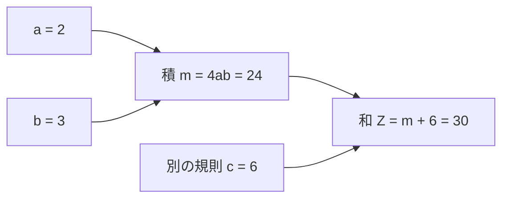
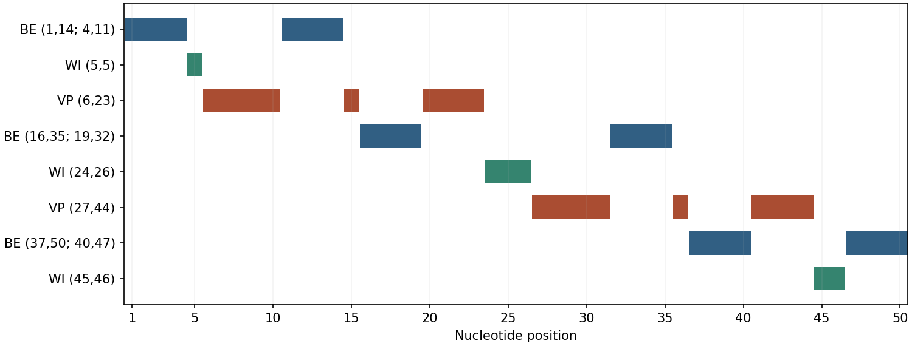

# 式でたどる inside・outside と BE

最終目標は塩基対 $(i,j)$ の確率を求めることに置く。足場 $G$ は必ず含める対の集合、$x$ は塩基配列、$n$ はその長さとする。以下の確率はすべて $x,G$ を固定した条件付き確率である。最初に分配関数を組み立て、次にその式を微分し、最後に同じ手順を LinearKnot の結合規則に当てはめる。

## 1　一つの図を二度読む

状態は部分問題に名前と座標を付けたもの。根 $r$ は全体、子 $A,B$ はその材料である。$I(A)=a,I(B)=b$ をそれぞれの部分問題の重みの総和とする。下図の各矢印は、矢印の先の計算に値を渡すことを表す。

順方向では $a,b$ を $m$ に代入し、その結果を $Z$ に代入する。逆方向では同じ図を右から左へたどり、矢印ごとの変化率を掛ける。例えば $a$ から $Z$ までの道なら

$$
\frac{\partial Z}{\partial a}
=\frac{\partial Z}{\partial m}\frac{\partial m}{\partial a}
=1\cdot 4b=12.
$$

関心のある出力を $Z$ として、途中の値 $y$ に対する微分を $\bar y=\partial Z/\partial y$ と書くと、この図を逆に評価する全手順は

$$
\bar Z=1,\qquad
\bar m=\bar c=1,\qquad
\bar a=4b\bar m=12,\qquad
\bar b=4a\bar m=8.
$$

小さな変化による検算もできる。$a$ だけを $2.01$ に変えると $Z=30.12$ になる。元との差 $0.12$ を入力の差 $0.01$ で割ると $12$。この例では $Z$ が $a$ の一次式なので差分は微分と正確に一致する。

## 2　文法の規則を掛け算と足し算に移す

$d$ を完成した一通りの組み立て方（導出）とする。導出で使う規則の各回を $e$ と書き、その局所エネルギーを $E_e$、絶対温度を $T$、気体定数を $R$ とする。$w_e$ は規則の重み、$W(d)$ は導出の重みである。

$$
E(d)=\sum_{e\in d}E_e,\qquad
w_e=\exp[-E_e/(RT)],\qquad
W(d)=\exp[-E(d)/(RT)]=\prod_{e\in d}w_e .
$$

状態 $v$ を完成させる最初の規則を、分割位置を含めて $e$ とする。そこから要求される子を順に $u_1,\ldots,u_k$ とする。規則を一つ決めれば境界は固定され、各子に許された導出を一つずつ選べる。そこで、最初の規則ごとに導出をまとめ、積の分配法則を使うと

$$
I(v)=\sum_{e:\,v\to(u_1,\ldots,u_k)}
w_e\prod_{h=1}^k I(u_h),\qquad
Z=I(r)=\sum_d W(d).
$$

例えば子が二個、左の選択肢の重みが $1,3$、右が $4,5$、規則の重みが $2$ なら、一つずつ展開した結果は $8+10+24+30=72$。式にまとめても $2(1+3)(4+5)=72$。これにより、導出の一覧を作らずに重みを合計できる。子のない規則では空の積を $1$ とする。許される規則が一つもない状態は空の和で $0$ になる。

一つの完成構造 $S$ を出す導出が複数ある場合には、$S(d)$ を導出 $d$ が出す構造として
$$
P(S\mid x,G)=\frac{1}{Z}\sum_{d:\,S(d)=S} W(d).
$$
モデルの意図が「構造ごとにエネルギー $E(S)$ を一度だけ数える」なら、この分子が $\exp[-E(S)/(RT)]$ に一致する必要がある。同じ重みの導出を誤って二通り用意すれば、その構造の重みも二倍になる。どの結合を許し、どの規則で各エネルギー項を払うかは[文法編](grammar.md)で説明している。

## 3　一般の outside と、一つの辺を使う頻度

$O(v)=\partial Z/\partial I(v)$ とおく。$I(v)$ を入力として使う計算が複数あるなら、そのどれを経由した変化も $Z$ に届くため寄与を足す。$O(r)=1$ から始め、親が先、子が後の順で、それぞれの規則と子の出現位置 $j$ に対し次を行う。矢印の左にある古い値へ右の項を加えるという意味である。

$$
O(u_j)\ \leftarrow\ O(u_j)+O(v)\,w_e\prod_{h\ne j} I(u_h).
$$

この式には子自身の値による割り算がない。例えば $Z=1+5a$ では $a=0$ でも $\partial Z/\partial a=5$。その場所が「実際に選ばれる確率」は $a$ を掛け戻して初めて得られる。$Z>0$ とし、$N_e(d)$ を一つの導出に現れる規則 $e$ の回数とすると

$$
\mathbb E[N_e]
=\frac{w_e}{Z}\frac{\partial Z}{\partial w_e}
=\frac{O(v) w_e \prod_h I(u_h)}{Z}.
$$

ここでは、位置まで固定した当該規則の重みだけを独立に動かしている。冒頭の規則は高々一回使われるので、平均回数はそのまま確率 $24/30=0.8$。同じ状態が一つの積に二回出る場合の算術例 $Z=a^2$ では $a(\partial Z/\partial a)/Z=2$。これは出現回数の平均として正しい。

## 4　微分で塩基対確率が出る理由

追加対 $p=(i,j)$ を一つ決め、その対を含む導出の重みだけに倍率 $t>0$ を掛ける。$H_p(d)$ は対があれば $1$、なければ $0$ とする。$Z_0,Z_1$ はそれぞれ、元の重みで合計した「対がない側」「対がある側」の和である。

$$
Z(t)=\sum_d W(d)t^{H_p(d)}=Z_0+t Z_1,\qquad
\left.\frac{\partial\log Z(t)}{\partial\log t}\right|_{t=1}
=\frac{Z_1}{Z_0+Z_1}=P(p\mid x,G).
$$

$\log$ は自然対数で、$\partial/\partial\log t=t\,\partial/\partial t$ が成り立つ。最初の図で $p$ が積の規則でのみ生成されるなら、$Z(t)=6+24t$。$t=1$ で $0.8$、$t=2$ としたモデルでは $48/54=8/9$ になる。実際には $t$ を各対で動かして何回も計算する必要はない。各規則について前節の平均回数を求め、その対を生成する規則の分を集めればよい。これには完成した導出でその対の生成をちょうど一回数えるという文法側の約束が必要である。固定対はどの許容構造にもあるので、$Z>0$ なら確率は $1$。

全体の自由エネルギー $F=-RT\log Z$ を使うと、確率には別の読み方もある。対 $p$ があるときだけエネルギーを $\epsilon$ 増やせば $t=\exp[-\epsilon/(RT)]$。したがって

$$
\left.\frac{\partial F}{\partial\epsilon}\right|_{\epsilon=0}
=(-RT)\frac{\partial\log Z}{\partial\log t}
\left(-\frac{1}{RT}\right)=P(p\mid x,G).
$$

## 5　穴のある BE で同じ微分を実行する

図の横軸は塩基番号、各行は一つの部分木である。最初の BE の腕は $[1,4]\cup[11,14]$。ここで $[a,b]$ は $a$ から $b$ までの整数の集合、$\cup$ は二つの集合を合わせる操作である。図の最初の三行は、次の一つの規則で同時に使う。

$$
\begin{aligned}
v &= \mathrm{WMBP}(1,23), & b &= \mathrm{BE}(1,14;4,11),\\
h &= \mathrm{WI}(5,5), & q &= \mathrm{VP}(6,23).
\end{aligned}
$$

$v$ は組み立て途中の交差部分、$b$ は固定対の二本の腕、$h$ は隙間、$q$ は足場と交差する対の部分である。規則の重みを $w$ とすると、順方向で足す一項 $M$ と、逆方向で $b$ に足す一項 $D_b$ は

$$
M=w I(b)I(h)I(q),\qquad D_b=O(v)\frac{\partial M}{\partial I(b)}
=O(v)w I(h)I(q).
$$

仮に $(w,I(b),I(h),I(q),O(v))=(2,3,1,5,7)$ なら $M=30,D_b=70$。同じ規則から $h$ へは $7\times2\times3\times5=210$、$q$ へは $7\times2\times3\times1=42$ が返る。三者にそれぞれ自分の内側を掛け戻すと $70\times3=210\times1=42\times5=210$。同じ親の同じ規則を経た寄与を、どの子の場所で切っても回収できている。

一方、$v$ の範囲 $[1,23]$ を「三つの子が今すべて埋める」と仮定すれば、16～19番を誰も埋めずに矛盾する。実際には後続の BE がそこを担当する。順方向で必要なのは、境界情報が接続に十分で、採用した規則の重みが正しく因数分解できること。逆方向で必要なのは、その**同じ計算**の依存関係をたどること。この二条件のどちらにも、各子が一本の連続した区間を占めるという仮定はない。
