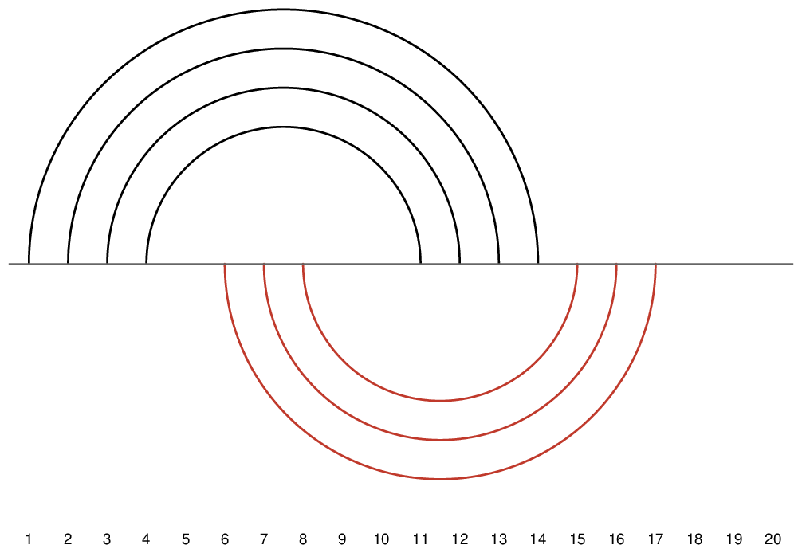
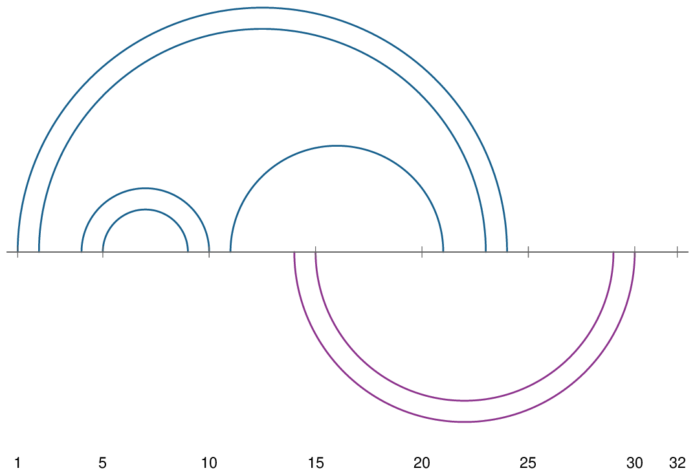

# LinearKnot が数え上げる RNA 構造

## 固定しておく対と、新たに選ぶ対

RNA 配列を、A、C、G、U のいずれかを書いた長さ $n$ の列とする。位置は左から 1, 2, …, $n$ と数える。塩基対 $(i,j)$ は、位置 $i$ と $j$ が組になるという指定で、左端を先に書く。1つの位置の相手は高々1つで、相手を持たない状態を未対合と呼ぶ。塩基対を列の上の弧として描くと、2つの弧の端が交互に並ぶときに交差する。例えば $(2,9)$ と $(6,13)$ は $2<6<9<13$ なので交差し、$(2,13)$ と $(6,9)$ は入れ子になる。交差を含む構造を擬似ノットと呼ぶ。

入力には配列とともに、必ず含める互いに交差しない塩基対の集合 $G$ を与える。これが **scaffold（足場）** である。追加する対の集合を $G'$ と書く。固定対の端を再利用せず、追加する対は互いに交差せず、固定対とは交差できる。完成構造は $G$ と $G'$ を合わせた集合である。この階層折り畳みモデルは、さらに後述の density-2 条件を課す。実装は塩基種、ループ長、区間の境界などの採用条件を課す。例えば追加対では A–U、G–C と G–U（揺らぎ対と呼ばれる組合せ）が候補になる。固定対のない入力では、追加対どうしの非交差性から完成構造も非交差になる。

## 20塩基の弧図でバンドを見つける

横方向が塩基の順序、1つの弧が1つの塩基対を表す。黒は固定した $G$、赤はこの例で選んだ $G'$。教科書は2つの集合を見分けやすくするため、黒を上側、赤を下側に描く。「交差」はここでも、左右の端点が交互に並ぶことを意味する。まず黒の最も外の弧を左端から右端へたどると $(1,14)$ である。その内側には $(2,13),(3,12),(4,11)$ が並ぶ。赤の最も外の弧 $(6,17)$ の左端はこの黒い4対の内側、右端は外側に出る。例えば $4<6<11<17$ から $(4,11)$ と $(6,17)$ の交差が読める。赤の残り2本 $(7,16),(8,15)$ にも同じ端点の順序が成り立つ。従ってこの図では黒の4対、赤の3対のすべてが**擬似ノット塩基対**（完成構造の中で少なくとも1対と交差する対）である。

**どこまでが1つの band か。** 区間 $J$ に端が1つでも入る対について、もう一方の端も $J$ に入るとき、$J$ はその対集合に関して**弱閉**である。対がない区間も空区間もこの条件を満たす。例えば $[5,10]$ は黒い対の端を含まないので $G$ に関して弱閉だが、完成構造では 6 番の相手 17 番が外にいるので弱閉性が破れる。完成構造を $R=G\cup G'$ とする。2つの異なる入れ子の擬似ノット塩基対 $(a,q),(c,s)$ を $a<c<s<q$ の順に取る。両対の左端の間 $[a+1,c-1]$ と右端の間 $[s+1,q-1]$ がそれぞれ $R$ に関して弱閉なら、内対は外対に *directly banded in* される。この関係でたどれる入れ子の列を、それ以上延ばせないところまで取ったものが **band（バンド）**である。図で隣り合う黒の $(1,14)$ と $(2,13)$ の間には左右とも塩基がない。次の2組も同様で、黒の4本が1つ、赤の3本がもう1つのバンドを作る。黒の外対と内対を指定すると、**腕**は $[1,4]$ と $[11,14]$ になる。

**真ん中の6塩基を誰が使うか。** 黒の腕を受け持つ項目を $b=\mathrm{BE}(1,14;4,11)$ と書く。この表記でセミコロンの前が外対、後が内対である。BE は指定された2対までの腕を評価するので、同じ列から例えば $\mathrm{BE}(2,13;4,11)$ という短い部分も切り出せる。20 塩基例で $b$ と同時に選ばれた2つの子は $u=\mathrm{WI}(5,5)$ と $v=\mathrm{VP}(6,17)$。5 番は $u$、赤い3対とその内側に残る位置は $v$ が受け持つ。3つの領域を照合すると、$[1,17]$ の各塩基が1度ずつ現れる。

| 子 | その部分木が受け持つ位置 | 図から読み取れる仕事 |
|---|---|---|
| $b$ | $[1,4]\cup[11,14]$ | 黒い4対の左右の腕 |
| $u$ | $\{5\}$ | 黒の左腕から赤の左腕に移る間の未対合塩基 |
| $v$ | $[6,10]\cup[15,17]$ | 赤い3対の両端と、9、10 番の未対合塩基 |

従ってこの規則は、局所重みを $w$ とすれば $w\,\alpha(b)\alpha(u)\alpha(v)$ を親の inside に足す。中央 $[5,10]$ の仕事は $u,v$ が引き受け、黒い右腕 $[11,14]$ は $b$ が引き受ける。座標範囲が $[6,17]$ の $v$ を、一続きの全塩基を採点する項目として解釈すると、この割り当てを再現できない。[20塩基の導出木](derivations/case1.md)

**腕の途中に別の枝を入れたらどうなるか。** 32 塩基例の $(2,23)$ から $(11,21)$ に移る1段を拡大して読む。左端の間 $[3,10]$ にはヘアピンを作る枝 $(4,10),(5,9)$ がすべて収まる。右端の間には位置 22 のみが残る。この2つの間隔もそれぞれ弱閉である。内外の対が隣接するスタックより広いこの配置で、左の枝を受け持つ子が $\mathrm{WIP}(3,10)$ になる。右の 22 番は未対合として親の局所重みで数える。バンドは、図で連続して積み重なった弧だけを探すと見落とす。[32塩基の導出木](derivations/band_wip.md)

**density を数える。** バンドを頂点とし、その中の対が互いに交差する2つのバンドを辺で結ぶ。辺をたどって互いに到達できるバンドのまとまりを1つ取る。位置 $k$ を厳密に内側に含む外対（$a<k<q$）を持つバンドの本数を各位置で数え、その最大がそのまとまりの density である。20塩基例では、例えば $k=8$ は黒の外対 $(1,14)$ と赤の外対 $(6,17)$ のどちらの内側にもある。この図にはこの2バンドだけがあるので最大は 2。すべてのまとまりについて最大が 2 以下であることが、ここでの density-2 条件である。

## 部分問題に名前をつける

**文法**とは、許す構造を部分問題への分解で指定する規則の集まりである。部分問題の種類を表す名前を **非終端記号** といい、具体的な位置を付けたものを **項目** と呼ぶ。例えば $V(2,9)$ の値を決める条件の1つは、両端 2 と 9 が組になることである。どの規則を使うか、どの位置で分けるかを決めると、必要な子項目が決まる。親から子へこの選択を繰り返し、子のない規則に行き着くまでを木に描いたものが **導出** である。

以下では、ある対で囲まれた領域を内側から眺める。内側に枝（さらに対で閉じた部分）がなければヘアピン、内側の対に連なるとき両側に隙間がなければスタック、一方または両方に未対合塩基があれば広義の内部ループである。複数の枝をまとめて囲む部分を多分岐ループと呼ぶ。

|実装の状態名|この部分問題が受け持つもの|
|---|---|
|W|配列の外側から完成させる部分。配列全体は W(1,n)。末端を未対合で延ばすか、閉じた枝を足す。|
|V|交差しない側の対で閉じた部分。ヘアピン、内側の対への接続、多分岐への接続を選ぶ。|
|VM|V の閉じ対の内側で複数の枝、または1つの WMB の枝を使って多分岐を閉じる。|
|WMv、WMp|多分岐ループの枝を1つ用意する。v 側は V、p 側は完成した擬似ノット部分 WMB を使う。|
|WM|多分岐ループ内で枝を並べる途中の部分。枝の追加や未対合塩基による延長ができる。|
|VP|新たに作る、足場と交差する対を両端に持つ部分。内側へ延びる対、または交差する足場の間の隙間へ分解する。|
|WI|交差部分の隙間を埋める。未対合、V の枝、完成した WMB の枝を組み合わせる。|
|WIP|バンドにまたがる多分岐ループの腕を担当する。枝を含む腕の規則に使う。|
|VPL、VPR|VP の左右に腕をつなぐ分解を途中まで組み立てる補助状態。分割位置を保って、腕と VP を所定の順序で結合する。|
|BE|固定対のバンドを外側の固定対から指定した内側の固定対までたどり、対と対の間の両腕を計算する。|
|WMBP|交差するバンドのつながりを途中まで組み立てる。右端側に、後で勘定する固定バンドが残りうる。|
|WMBW|WMBP の右側に WI をつないだ途中の状態。|
|WMB|完成した擬似ノット部分。既定の規則では、範囲の内と外を結ぶ固定対が残らないように境界を検査する。これを足場に関する弱閉性と呼ぶ。|

この表は現行実装の15種類をひととおり含む。プログラムとの対応を探すときは名前と展開先で照合できる。[非終端名](../../src/scfg2/grammar/nonterminal.hh)・[規則名と子の種類](../../src/scfg2/grammar/rules.hh)

## 3つの具体的な分解

1. **外側から最後の位置で分ける。** W が末端を未対合にする選択では、その前までを計算して末端の寄与を掛ける。末端が通常の枝の右端なら、その枝の左端を選び、前の部分と V の値を掛ける。末端側が交差を含む完成した塊なら WMB を使う。これらは同じ外側の状況に対する複数の選択肢だから、最終的には足す。
2. **交差対の内側の隙間を埋める。** 固定対 $(4,11)$ を新しい対 $(1,8)$ が横切る例を考える。位置 4 は固定対の端である。区間 2〜7 をひとまとめに通常のループとして計算すると、その端を外との接続から切り離してしまう。VP の規則は足場を先に調べ、端が属する領域の境界を使って、WI に渡す隙間を選ぶ。配置によって隙間は2つまたは3つになる。許された空の WI の隙間は積に 1 を寄与する。枝を要求する WIP に同じ扱いをすると、枝がない多分岐ループを数えてしまう。[境界ごとの展開](../../src/scfg2/deductions/README.md)
3. **BE の中央を空ける。** 足場に $(2,15),(3,14),(4,13)$ があるとする。BE の外側の目印を $(2,15)$、内側の目印を $(4,13)$ とする。2つの連続したスタックを通って内側の目印に到達する。2つの目印が同じになると、この経路についてそれ以上たどる部分はない。各スタックの局所重みを順に $a,b$ とすれば、この経路の重みは $a\times b\times1$ である。最後の 1 は同じ固定対に到達したときの重みである。腕が通る座標は左の 2〜4、右の 13〜15 で、中央の 5〜12 に何を作るかをこの BE のスタック規則は選ばない。目印は他の規則も参照できる。目印を共有することと、同じ対のエネルギーを2回加えることは別である。途中に未対合の隙間があれば内部ループとして、枝のある腕なら WIP を子に取る規則で評価する。[BE の局所重み](../../src/scfg2/weights/be_transition.hh)

## なぜ分配関数になるか

各規則を1回使ったときの局所エネルギーを $e$、絶対温度を $T$、エネルギーと同じ単位系の気体定数を $R$ とする。規則には $w=\exp(-e/(RT))$ という正の数を与える。これを **ボルツマン重み** と呼ぶ。導出のエネルギーは各段階の $e$ を足した値なので、導出全体の重みは各段階の $w$ を掛けた値になる。分配関数とは条件を固定したときの、許す完成構造の重みの合計である。

本教材の $\alpha$（inside）と $\beta$（outside）は実数の重みで表す。教科書の擬似コードに出る対数表との換算は[教科書と記号の対応](textbook-guide.md#実数の重みと教科書の-log-表)に示す。

項目 $A$ が作れる導出の重みの和を $\alpha(A)$ とする。$d$ を $A$ の最初の規則の選択（分割位置も指定済み）、$w_d$ をその重み、$C(d)$ を子項目の列と書く。すると
$$ \alpha(A)=\sum_d w_d\prod_{B\in C(d)}\alpha(B). $$
子がない選択では積は 1、候補が1つもない項目では和は 0 である。例として、ある規則の重みが 2、左の子に重み 1 と 3 の選択、右の子に 4 と 5 の選択があるとする。目印が決まった後は左右の選択を組み合わせられるので、4通りの合計は $2(1+3)(4+5)=72$。別の規則で重み 7 の完成形も作れれば項目の合計は 79 になる。これは分配法則であり、数字は計算法を見せるための例である。子から親の順に各値を表に1度保存し再利用する計算が **動的計画法** である。

ここで証明できたのは導出の重みの和である。$\alpha(W(1,n))$ を構造の分配関数にするには、許す構造を分解がすべて覆い、構造ごとの導出の重みの合計がその構造に与えたい重みに一致する必要がある。既定モデルでは CParty の分解に従い、同じ分割位置と固定対の目印を保って、複数の積を決まった順番で組み立てる。例えば3つの隙間の積に新しい括弧を付けても、括弧付けを1種類だけ使えば選択肢は増えない。WMB を完成する時の弱閉性は、一部の固定バンドを後で足せる状態を、既に完成した枝として再使用するのを防ぐ。この対応と局所エネルギーの1度ずつの計上が、足場を固定した分配関数を得るモデル上の根拠になる。実装で有限個の例を全列挙して比較する検証は、このモデルの根拠をプログラムの側から点検するものになる。旧実装に合わせる互換設定では弱閉性の条件が緩くなり、同じ完成構造に複数の導出を持つ例がある。[モデルの対応関係](../model.md)・[検証記録](../validation.md)

同じ式を途中で候補を絞らず評価する方式を exact と呼ぶ。各段階で高く評価した候補だけを残す方式を beam と呼ぶ。採択した状態と規則を固定すると、後者で得るのはその中で作れる導出に限った和である。いずれも BE が参照する座標を連続区間に直す必要はない。上の積と和が要求するのは、どの親がどの子を使ったか、組み合わせが許されるか、重みをどこで掛けたかという情報である。親側から「この子が完成にどれだけ寄与したか」を求める逆向き計算にも、同じ親子関係が使える。
