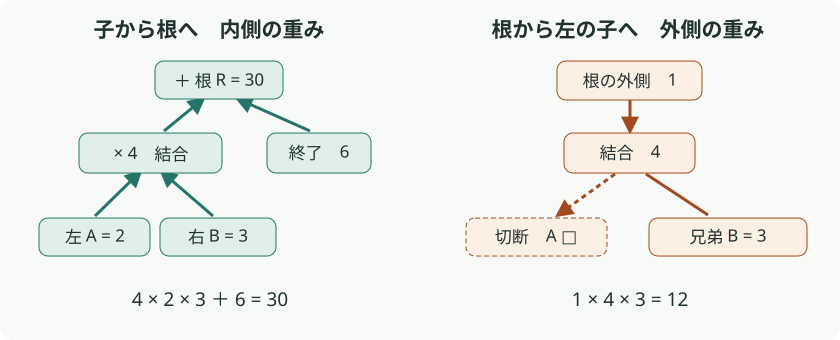

# 分配関数を作る順方向計算と、その計算を逆にたどる outside

本教材の $\alpha$（inside）と $\beta$（outside）は実数の重みで表す。教科書の擬似コードに出る対数表との換算は[教科書と記号の対応](textbook-guide.md#実数の重みと教科書の-log-表)に示す。

## 1　何を足すのか

RNA を、左から 1, 2, … と番号を付けた塩基の列とする。塩基対は結び付く2つの位置の組で、二次構造はその組の集合である。LinearKnot には配列と、構造に必ず含める交差のない塩基対の集合（scaffold、足場）を与える。交差とは2対の端が左から交互に現れることをいう。与えた条件の下で、どのような構造がどれだけの重みを持つかを知りたい。

構造を部品から組み立てる規則をまとめたものを文法、規則を最後まで選んだ1通りの組み立て方を導出という。規則を1回適用する際のエネルギーの寄与を ΔE とすると、その局所重みは exp(−ΔE/(RT)) である。exp は自然指数関数、T は絶対温度、R は ΔE の単位に合わせた気体定数である。エネルギーを足し合わせると重みは掛け合わされる。この積を導出全体の重みとする。すべての許された導出の重みを足したものが分配関数 Z で、Z が正なら各重みを Z で割って確率にできる。知りたい事象が「この対がある」なら、その条件を満たす導出の確率を足せばよい。複数の導出が同じ出力を与える場合、出力の確率にはそのすべてが寄与する。意図した構造集合を過不足なく表す責任は文法にある。

## 2　子から親へ数える inside

「どの種類の部品を、どの位置で作るか」を指定した計算単位を**状態**と呼ぶ。ある状態を完成させる規則は複数あり得る。1つの規則に必要な材料となる状態を子、完成する状態を親という。位置や分割点まで決めた1回の規則の選択を e、その局所重みを w(e) と書く。α(v) は状態 v を作る全導出の重みの和で、これを **inside** と呼ぶ。

$$
\alpha(v)=\sum_{e\text{ が }v\text{ を作る}} w(e)\prod_{u\text{ は }e\text{ の子}} \alpha(u).
$$

Σ はその下の指定に当てはまる値の足し算、Π は掛け算を表す。和は選択肢、積は同時に必要な材料を表す。子がゼロ個の規則では積を 1 とする。使える規則が1つもない状態の和は 0 である。子同士の組合せが可能かは規則が位置と境界条件で判定する。その判定を通った子の候補を独立に組み合わせられるから、個別の全組合せを展開した和と inside 値の積が一致する。

位置と規則の候補が有限で、親から子を追って同じ状態へ戻る循環がないとする。すると子を必ず親より前に並べられる。同一区間の状態どうしに依存があるときは、同じ長さの中でも規則の依存順に並べる。まず子の値を計算し、それを使って親を計算する。全体を作る最終状態 r の値 α(r) が Z になる。途中の値を保存して再利用するこの方法を動的計画法（DP）と呼ぶ。ここでの forward は値を求める向きである。配列の左から1文字ずつ処理することを意味するわけではない。

## 3　根から子へ戻す outside

α(v) の計算結果を受け渡す1点で、その数値だけ少し増やしたら、Z はどれだけ増えるか。その変化率を偏微分と呼び、β(v) = ∂Z/∂α(v) と書く。これが重みを通常の実数で扱うときの **outside** である。導出の木（親から子へ規則を展開した図）で v の出現を1つ選び、その部分木だけを穴として残す。穴の外にある規則の重みを掛け、そのような穴付きの組み立て方すべてについて足した値、とも読める。

最初に β(r)=1、それ以外を 0 と置く。親 v に寄与した規則 e の子の個数を m、順番に並べた子を u₁,…,uₘ とすると、順に各位置 k へ

$$
\beta(u_k)\mathrel{+}=\beta(v)\,w(e)\prod_{h\ne k} \alpha(u_h)
$$

を足す。「+=」はそれまでの値への加算を表す。積の添字 h は子の番号で、k 番目だけを除いて掛ける。穴にする子だけを取り除き、兄弟の inside をすべて掛けると、親の外側が子の外側になる。1つの状態を使う親が何通りもあるため加算が要る。根から始め、各状態について自分を使う親の処理が終わってから子へ進む。積の微分と、入れ子になった関数の微分を掛ける連鎖律をそのまま使った式である。

**自動微分**は、実際の計算が行う足し算や掛け算をたどり、連鎖律で微分を組み上げる手法である。出力から入力へ変化率を戻す方式を逆モード、戻す計算を backward と呼ぶ。inside は元の計算の forward、outside はそれに対する逆モードの backward に当たる。微分する入力の方向を先に決め、値とその変化率を一緒に先へ送る「順モード自動微分」も存在する。inside の計算だけではまだ微分していない。

### 同じ組み立てを、埋める向きと切る向きから読む

動画の第2・3章と同じ数で考える。根 R には「A と B を同時に使う」と「何も使わず終わる」という2つの規則がある。次の図の左半分は **複数の導出をまとめる計算** であり、完成した導出を1つだけ描いた木ではない。実際の導出では ＋ の選択肢の1つを選ぶ。× の下の子は両方とも必要になる。

右図では、左図の結合規則を1つ選び、**左の子を取り外す位置** に □ を置いた。兄弟とは、この結合で同時に選ぶもう1つの子である。A を含まない終了規則からは、A を取り外す場所を選べない。

□ に重みを何も入れずに周囲だけを数えると、A の外側は $1×4×3=12$。そこに A の中身を戻すと、A を通る全導出の重み $12×2=24$ になる。根全体の重み 30 で割ると A を使う確率は $24/30$。右の子を切れば左の A が兄弟に変わり、B の外側は $1×4×2=8$ になる。切った先にいくつの塩基があるかを数える操作は、この計算には登場しない。

## 4　手で計算する3つの例

**2つの組み立て方。** 根の選択肢が「何もしない（重み 1）」と「重み 2 の規則で A と B をつなぐ」の2つで、α(A)=3、α(B)=5 とする。数値は説明用の重みである。Z=1+2×3×5=31。β(A)=2×5=10、β(B)=2×3=6 となる。A の inside を 3.1 に変えると Z は 32 に変わり、変化率は (32−31)/0.1=10。A を使った導出の総重みは 10×3=30、確率は 30/31 である。outside 自体は確率ではない。

**2つの親が同じ子を使う。** α(X)=2、α(A)=3α(X)、α(B)=5α(X)、Z=α(A)+α(B) とする。β(A)=β(B)=1 なので β(X)=3+5=8。2つの経路の寄与を片方だけ使うと、正しい Z=16 を説明できない。さらに積の中で同じ子を2回使う算術例 Z=α(X)² なら、X の1回目と2回目の両方に微分が流れて β(X)=4。β(X)α(X)/Z=2 は、導出中に X が出る**平均回数**になる。状態が高々1回現れる場合に限って、この式は出現確率とも一致する。

**ある塩基対の確率。** 1つ目の例で、A と B をつなぐ規則だけが塩基対 p を1回生成するとする。その規則の重みに仮の倍率 t を掛けると Z(t)=1+30t。自然対数を log と書く。t=1 における ∂log Z/∂log t は (1/31)×30=30/31 となり、先ほどの確率に一致する。一般にも規則 e が使われる平均回数は β(v)w(e)Π α(u)/Z である。対 p を生成するすべての規則の寄与を足せば、完成した導出で p をちょうど1度数えるという条件の下で、p の塩基対確率（BPP）が得られる。足場の対は条件として固定され、許された全構造に含まれるので確率は 1 である。

## 5　BE の中央に穴があってもよい理由

足場の2対 (i,j) と (k,l) が i<k<l<j を満たすとする。外側の対から内側の対までの左右の腕をまとめる文法状態が BE である。例えば (1,12) と (3,10) を境界にすると、両腕は位置 1～3 と 10～12 にあり、中央の 4～9 はこの2本の腕に含まれない。境界の対は状態をつなぐ目印でもある。別の状態が同じ目印を参照するとき、対を新たに作るエネルギーを自動的に二重加算するという意味ではない。

紙に「左右の腕の状態 B の値 3」「中央を含む残りを処理した状態 C の値 5」と書き、この2つを重み 2 で結合できる1項を考える。これは腕と中央の担当を説明する算術例で、LinearKnot の規則名を省略した実際の生成規則ではない。この項の重みは 30、B に返す寄与は親の outside の 2×5 倍となる。微分したのは2つの値の積で、塩基番号が連続するかどうかはどこにも登場しない。

実際に確認すべきは、①4つの位置が固定した2対に対応すること、②同じ状態を再利用してよいだけの境界情報を持つこと、③子・兄弟・親の規則のどれが塩基、対、エネルギーを担当するかが定まり、全導出で取りこぼしや二重計上がないこと、④子の値を先に確定できる計算順があること、である。中央を何にでも自由に使えるという意味ではない。各規則の許す組合せを forward と backward で同じにする。これは二次元の区間状態にも4つの番号を持つ状態にも共通する。

実装上の反例がある。交差対を扱う VP という状態の位置が 19～67 にまたがり、その2つの子が 20～35 と 63～66 を担当する。実際の完成構造には対 (49,53) もある。これは別の足場の枝で生成されるので、VP の担当とみなすと本来可能な構造の重みを誤って 0 にしてしまう。バージョン 0.2.2 では、特定の完成構造の確率を求める判定を、それぞれの規則が実際に生成する対と非対合位置に合わせた。この例は区間の両端と担当範囲を混同したときの失敗を示す。[回帰テスト](../../test/scfg2_vp_wmbp_composed_beam_test.cc)

## 6　計算機では何が違うか

- **対数を保存する場合。** 桁が広く変わる重みを扱うため、a(v)=log α(v) を保存できる。和を取る際には、対数値から元の値の和の対数を求める。log Z を a(v) で微分した値は、α(v)>0 なら β(v)α(v)/Z。実装上 β(v) 自体を対数で保存する場合、その値は log β(v) になる。いま求めた α(v)β(v)/Z は log Z を対数 inside で微分した値で、同じ「対数」という言葉でも2つの量は数値が異なる。
- **値が 0 の場合。** ある積を子の値で割って兄弟の積を出すと、子の値が 0 のとき破綻する。兄弟だけを掛ければよい。例えば Z=1+X×5 は X=0 でも ∂Z/∂X=5 になる。実装も子の各出現を区別し、兄弟の値を掛けて伝える。[outside 実装](../../src/scfg2/engine/outside.hh)
- **候補を減らす場合。** 途中で残す状態の数を絞る方法を beam（ビーム）と呼ぶ。残した状態と規則を固定した計算に対しては、同じ微分式が使える。どの候補が残るかの順位選択は別の操作で、順位が入れ替わる変化まではこの微分に含まれない。forward 時点で別の候補が生きていたなら、最後の表から当時の計算を単純に復元することもできない。LinearKnot では保持した状態上で定めた計算に対応する outside を評価する。[実装の説明](../../src/scfg2/engine/README.md)・[beam の outside](../../src/scfg2/beam/retained_outside.hh)

「最もよい構造を1つ選ぶ」問いには、選択肢の重みの最大を取る計算を使う。「多くの候補を通じて、この対はどれだけ選ばれるか」には選択肢を足す inside と、その和に含まれる寄与をたどる outside を使う。どの問いに答えるかで、同じ文法に適用する演算が変わる。実際の部品と接続条件は[文法編](grammar.md)で扱う。

## 7　1本道の forward–backward から木の inside–outside へ

各時刻に少数の状態があり、隣り合う時刻の間だけを移動できるモデルを考える。ある状態までの経路の重みの和を α、そこから終点までの経路の重みの和を β と書く。経路の重みは通った矢印の重みの積とする。始点から前向きに α を計算し、終点から後ろ向きに β を計算するのが、このモデルの forward–backward 法である。

例えば道が「始点 → A → 終点」と「始点 → B → 終点」の2つだけで、それぞれ矢印の重みが (2,5) と (3,7) なら、Z = 2×5 + 3×7 = 31。α(A)=2、β(A)=5 であり、A を通る確率は 10/31。A までの値 2 を変数 x に置き換えれば Z(x)=5x+21 なので、その微分は 5、つまり β(A) そのものになる。

1本道では1回の移動に必要な直前の状態は1個である。文法では親を作る1手に子が2個、3個と必要になる。そのため、1つの子に後ろ向きの寄与を返すとき、**同じ規則で同時に必要だった兄弟の内側の値**が現れる。これが順方向・逆方向という共通点と、線形な経路から文法へ進んだときの式の違いを結び付けている。自動微分における「順モード」は、入力に与えた微小変化も値と一緒に順方向へ伝える方式を指す。通常の inside の値を求める順方向計算の段階では、微小変化を伝える必要はない。

この対応を文法と経路の両方から導く参考文献に [Eisner (2016), *Inside-Outside and Forward-Backward Algorithms Are Just Backprop*](https://aclanthology.org/W16-5901/) がある。RNA の構造と分解の原典は [Gray らの CParty 論文と補足資料](https://doi.org/10.1093/bioinformatics/btae748)。
