# 15 種類の部分問題から構造を組み立てる

RNA の配列と、必ず残す互いに交差しない塩基対の集合（足場）を固定する。構造は完成した対の集合であり、各位置の相手は高々一つである。状態を展開して一つの構造を得る手順を導出と呼ぶ。途中の選択肢をすべて残して計算する方式を exact と呼ぶ。基本の用語は[語彙ガイド](first-words.md)、モデルへの導入は[文法編](grammar.md)にある。

## 位置付きの規則を読む

部分問題の種類を非終端記号、種類と具体的な座標の組を項目と呼ぶ。区間の両端 $i,j$ を含め、位置は 1 から数える。BE では外側の対 $(i,j)$ と内側の目印 $(u,v)$ の四つの座標を使う。$k,l,p,q$ は規則ごとに選んだ分割位置または足場から引いた位置であり、候補から一組を選ぶと親・子の値を参照する場所が決まる。

親 $A$ が規則 $r$ と分割位置の組 $s$ を選ぶと、その場で掛ける局所重みを $w_{r,s}$、子の順序付き列を $C_{r,s}$ と書く。重みはエネルギー $E$ に対する $\exp[-E/(RT)]$ で、$T$ は絶対温度、$R$ は気体定数。以下の「子の積」の各項目名は、その項目で作れる全導出の重みの和 $I$（inside）を表す。したがって各行の子の積に $w_{r,s}$ を掛け、許された分割位置と規則について足すと親の値になる。

$$I(A)=\sum_{(r,s)\ \mathrm{admitted}} w_{r,s}\prod_{B\in C_{r,s}}I(B).$$

表中の 1 は空の積で、子のない規則も局所重みを掛ける。空にできる WI や左接頭辞を持つ規則では、その長さがゼロの場合の子を省く。各規則の座標は[実装の展開関数](../../src/scfg2/deductions/expand_basic.hh)、許される分割位置や足場の条件は[候補の生成関数](../../src/scfg2/deductions/generate_exact_basic.hh)に対応する。名前があることと正の重みで root（全体の項目）に寄与することを区別する。

**局所重みの表記。** 以下の表では PS などのパラメータ名を、その費用に対応するボルツマン因子の略記として使う。因子どうしを並べたら積、`a^k` は因子 a の k 乗。H はヘアピン、L は通常の内部ループ（スタックを含む）、X は外側の枝、M は通常の多分岐を閉じる部分、S はそこに置く通常の枝の重みで、括弧内が評価する対の位置である。c は通常の多分岐の未対合一個の因子、b はその枝にかかわる因子。PS、PSM、PSP はそれぞれ外側、多分岐内、交差部分の隙間内で擬似ノットを始める費用に対応する。PB はバンドを始める費用、PUP は交差部分の隙間の未対合、PPS はその中に閉じた枝を置く費用。ap、bp、cp はバンドにまたがる多分岐の開始、枝、未対合塩基に使う因子である。重みの記号 S と塩基配列のラベルを混同しないよう、表内では S に枝の座標を添える。[現行実装の局所重み](../../src/scfg2/replay/w_final_exact_inside.hh)

## W が担当する部分

**座標例。** 20 塩基例で W(1,20) は未対合の20番を除き W(1,19) に進む。

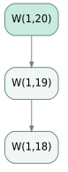

[全体の木](derivations/case1.md)

外側から、右端が未対合か、通常の枝または交差を含む完成した枝の端であるかを決める。根は W(1,n)。単一塩基の状態では右端延長を子なしで扱う。

|規則|選んだ一回の展開に含まれる子の積|選択の意味|局所重み|
|---|---|---|---|
| `W_EXTEND_UNPAIRED` | $I(\mathrm{W}(i,j-1))$ | 右端の未対合一個を追加する。 | $1$ |
| `W_SPLIT_V` | $I(\mathrm{W}(i,k-1))\,I(\mathrm{V}(k,j))$ | 外側の前半のあとに、右端 j で終わる通常の対で閉じた枝を加える。 | $X(k,j)$ |
| `W_SPLIT_WMB` | $I(\mathrm{W}(i,k-1))\,I(\mathrm{WMB}(k,j))$ | 外側の前半のあとに、右端 j で終わる完成した擬似ノット部分を加える。 | $\mathrm{PS}$ |
| `W_ROOT_WMB_DECOMPOSITION` | $I(\mathrm{W}(i,p-1))\,I(\mathrm{WMB}(p,k))\,I(\mathrm{W}(k+1,j))$ | 全体の先頭を含む項目で足場の目印から境界を引く補助分解。候補や子の値が残る条件を伴う。 | $\mathrm{PS}$ |

## V が担当する部分

**座標例。** 32 塩基例の V(4,10) は V(5,9) とスタックし、後者が6～8番のヘアピンを閉じる。

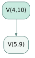

[全体の木](derivations/band_wip.md)

両端を組にする通常の枝。内側に枝がゼロなら折り返し（ヘアピン）、一つなら左右の未対合を挟む内部ループで、左右とも長さゼロならスタック。複数の枝をまとめる場合は VM に渡す。

|規則|選んだ一回の展開に含まれる子の積|選択の意味|局所重み|
|---|---|---|---|
| `V_HAIRPIN` | $1$ | 末端のヘアピンを閉じる。 | $H(i,j)$ |
| `V_INTERNAL` | $I(\mathrm{V}(k,l))$ | 通常の内部ループ・スタックを選ぶ。 | $L(i,j;k,l)$ |
| `V_VM` | $I(\mathrm{VM}(i,j))$ | 多分岐を閉じる経路へ渡す。 | $1$ |

## VM が担当する部分

**座標例。** 37 塩基例の VM(4,34) は WM(5,19) と WMv(20,33) を結ぶ。閉じ対の4番と34番は両方の子の外に残る。

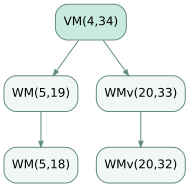

[全体の木](derivations/multiloop.md)

対 (i,j) で多分岐の部分を閉じる。分割した WM は先行する枝の列、右の子は最後の枝。左に枝がなく、右が擬似ノット部分を含む一本の枝になる特別な開始も区別する。

|規則|選んだ一回の展開に含まれる子の積|選択の意味|局所重み|
|---|---|---|---|
| `VM_SPLIT_WM_WMv` | $I(\mathrm{WM}(i+1,k-1))\,I(\mathrm{WMv}(k,j-1))$ | 前の枝列のあとに通常の最後の枝を置いて多分岐を閉じる。 | $M(i,j)$ |
| `VM_SPLIT_WM_WMp` | $I(\mathrm{WM}(i+1,k-1))\,I(\mathrm{WMp}(k,j-1))$ | 前の枝列のあとに擬似ノットを含む最後の枝を置いて閉じる。 | $M(i,j)$ |
| `VM_SPLIT_WMp_BASE` | $I(\mathrm{WMp}(k,j-1))$ | 左に通常の枝を置かず、単一の擬似ノット枝と左の未対合列を評価する。 | $c^{k-i-1}\,M(i,j)$ |
| `VM_SCALE2` | `—` | 識別子だけが残る。exact の VM の選択肢に含めない。 | 適用なし |

## WMv が担当する部分

**座標例。** 37 塩基例で WMv(20,33) は右端を3塩基短くして WMv(20,30) となり、V(20,30) を枝に取る。

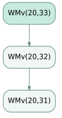

[全体の木](derivations/multiloop.md)

多分岐内の普通の枝一本とその右側の未対合を担当する。V が枝そのもの。右端からの延長は新しい枝を作らない。

|規則|選んだ一回の展開に含まれる子の積|選択の意味|局所重み|
|---|---|---|---|
| `WMv_STEM_V` | $I(\mathrm{V}(i,j))$ | この区間を単一の枝から作る。 | $S(i,j)$ |
| `WMv_EXTEND_UNPAIRED` | $I(\mathrm{WMv}(i,j-1))$ | 右端の未対合一個を追加する。 | $c$ |

## WMp が担当する部分

**座標例。** 仮に許された WMB(4,20) を多分岐ループの枝として受け取るなら、WMp(4,20) がその枝を包む。さらに21番を未対合にできる条件下では WMp(4,21) へ延びる。これは状態の接続を示す座標例である。

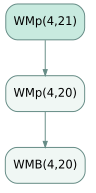

図は上の仮定を満たした場合の接続例。

多分岐内の交差を含む完成部分一本とその右側の未対合。枝が WMB となり、通常の V を使う場合と開始の費用が異なる。

|規則|選んだ一回の展開に含まれる子の積|選択の意味|局所重み|
|---|---|---|---|
| `WMp_STEM_WMB` | $I(\mathrm{WMB}(i,j))$ | この区間を単一の枝から作る。 | $\mathrm{PSM}\,b$ |
| `WMp_EXTEND_UNPAIRED` | $I(\mathrm{WMp}(i,j-1))$ | 右端の未対合一個を追加する。 | $c$ |

## WM が担当する部分

**座標例。** 37 塩基例で WM(5,17) は最初の枝 V(7,17) を取り、5、6番を左の未対合列として数える。

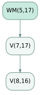

[全体の木](derivations/multiloop.md)

通常の多分岐の中の枝列。初めての枝の左側に未対合列を置ける。二本目以降は前の WM と最後の枝へ分解する。右端のみを一つ延ばす場合もある。

|規則|選んだ一回の展開に含まれる子の積|選択の意味|局所重み|
|---|---|---|---|
| `WM_START_V` | $I(\mathrm{V}(k,j))$ | 最初の枝と、その左の未対合列を引き受ける。 | $c^{k-i}\,S(k,j)$ |
| `WM_START_WMB` | $I(\mathrm{WMB}(k,j))$ | 最初の枝と、その左の未対合列を引き受ける。 | $c^{k-i}\,\mathrm{PSM}\,b$ |
| `WM_SPLIT_V` | $I(\mathrm{WM}(i,k-1))\,I(\mathrm{V}(k,j))$ | 多分岐内の先行する枝列のあとに、右端 j で終わる通常の対で閉じた枝を加える。 | $S(k,j)$ |
| `WM_SPLIT_WMB` | $I(\mathrm{WM}(i,k-1))\,I(\mathrm{WMB}(k,j))$ | 多分岐内の先行する枝列のあとに、右端 j で終わる完成した擬似ノット部分を加える。 | $\mathrm{PSM}\,b$ |
| `WM_EXTEND_UNPAIRED` | $I(\mathrm{WM}(i,j-1))$ | 右端の未対合一個を追加する。 | $c$ |

## WI が担当する部分

**座標例。** 20 塩基例の WI(9,10) は WI(9,9) と右側の未対合10番に分かれる。この経路では2塩基分の費用を払う。

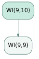

[全体の木](derivations/vp_UU.md)

交差する腕に挟まれた隙間。未対合だけでも、通常の枝 V や交差を含む枝 WMB を含んでいてもよい。空の許される隙間は親規則で省略する。長さ一の未対合は費用を持つ。

|規則|選んだ一回の展開に含まれる子の積|選択の意味|局所重み|
|---|---|---|---|
| `WI_BASE_SINGLE` | $1$ | 隙間に一つだけある未対合を数える。 | $\mathrm{PUP}$ |
| `WI_SPLIT_V` | $I(\mathrm{WI}(i,k-1))\,I(\mathrm{V}(k,j))$ | 交差領域の隙間の前半のあとに、右端 j で終わる通常の対で閉じた枝を加える。 | $\mathrm{PPS}$ |
| `WI_SPLIT_WMB` | $I(\mathrm{WI}(i,k-1))\,I(\mathrm{WMB}(k,j))$ | 交差領域の隙間の前半のあとに、右端 j で終わる完成した擬似ノット部分を加える。 | $\mathrm{PSP}\,\mathrm{PPS}$ |
| `WI_EXTEND_UNPAIRED` | $I(\mathrm{WI}(i,j-1))$ | 右端の未対合一個を追加する。 | $\mathrm{PUP}$ |

## WIP が担当する部分

**座標例。** 32 塩基例で WIP(3,10) は V(4,10) を枝に持ち、3番を未対合にする。

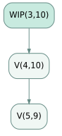

[全体の木](derivations/band_wip.md)

交差バンドをまたぐ多分岐の腕で、少なくとも一つ枝を要求する。左端からすぐ始まる枝、先行する枝の後の枝、未対合列の後の最初の枝、右の未対合延長を区別する。

|規則|選んだ一回の展開に含まれる子の積|選択の意味|局所重み|
|---|---|---|---|
| `WIP_BASE_V` | $I(\mathrm{V}(i,j))$ | この区間を単一の枝から作る。 | $\mathrm{bp}$ |
| `WIP_BASE_WMB` | $I(\mathrm{WMB}(i,j))$ | この区間を単一の枝から作る。 | $\mathrm{bp}\,\mathrm{PSM}$ |
| `WIP_SPLIT_V` | $I(\mathrm{WIP}(i,k-1))\,I(\mathrm{V}(k,j))$ | バンドをまたぐ多分岐の先行する腕のあとに、右端 j で終わる通常の対で閉じた枝を加える。 | $\mathrm{bp}$ |
| `WIP_SPLIT_WMB` | $I(\mathrm{WIP}(i,k-1))\,I(\mathrm{WMB}(k,j))$ | バンドをまたぐ多分岐の先行する腕のあとに、右端 j で終わる完成した擬似ノット部分を加える。 | $\mathrm{bp}\,\mathrm{PSM}$ |
| `WIP_BASEPAIR_V` | $I(\mathrm{V}(k,j))$ | 最初の枝と、その左の未対合列を引き受ける。 | $\mathrm{cp}^{k-i}\,\mathrm{bp}$ |
| `WIP_BASEPAIR_WMB` | $I(\mathrm{WMB}(k,j))$ | 最初の枝と、その左の未対合列を引き受ける。 | $\mathrm{cp}^{k-i}\,\mathrm{bp}\,\mathrm{PSM}$ |
| `WIP_EXTEND_UNPAIRED` | $I(\mathrm{WIP}(i,j-1))$ | 右端の未対合一個を追加する。 | $\mathrm{cp}$ |

## VPL が担当する部分

**座標例。** 左に未対合、右に枝のある実例で VPL(3,12) は VP(4,12) を子にして3番を未対合とする。

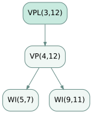

[全体の木](derivations/vp_UB.md)

VP の左に未対合列を添える途中の状態。足場による境界と長さが定まった候補だけを使い、その長さに応じた費用を掛ける。

|規則|選んだ一回の展開に含まれる子の積|選択の意味|局所重み|
|---|---|---|---|
| `VPL_SPLIT_VP` | $I(\mathrm{VP}(k,j))$ | 左側の未対合を局所重みで受け持つ。 | $\mathrm{cp}^{k-i}$ |

## VPR が担当する部分

**座標例。** 両腕に枝がある実例で VPR(8,21) は交差対 VP(8,16) と WIP(17,21) に分かれる。

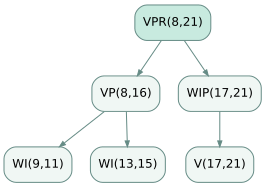

[全体の木](derivations/vp_BB.md)

VP の右に腕をつなぐ途中の状態。右に枝があれば WIP を置く。右が未対合列だけならその列の長さを規則自体で扱う。

|規則|選んだ一回の展開に含まれる子の積|選択の意味|局所重み|
|---|---|---|---|
| `VPR_SPLIT_VP_WIP` | $I(\mathrm{VP}(i,k))\,I(\mathrm{WIP}(k+1,j))$ | 左の交差対を含む部分に、少なくとも一本の枝がある右腕を添える。 | $1$ |
| `VPR_SPLIT_VP_BASEPAIR` | $I(\mathrm{VP}(i,k))$ | 右側 k+1～j を未対合列として親で数え、左の交差対だけを子にする。 | $\mathrm{cp}^{j-k}$ |

## VP が担当する部分

**座標例。** 50 塩基例の VP(8,21) は WI(9,10)、WI(15,15)、WI(20,20) を同時に使う。

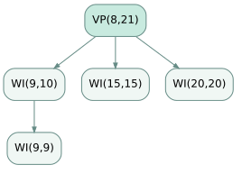

[全体の木](derivations/chain50.md)

足場の対と交差する追加対 (i,j) を作る。足場の境界が決める二つまたは三つの隙間を埋める、内側の交差対へつなぐ、枝を含む腕を作る、という候補を足す。

|規則|選んだ一回の展開に含まれる子の積|選択の意味|局所重み|
|---|---|---|---|
| `VP_WI_CASE1` | $I(\mathrm{WI}(i+1,p-1))\,I(\mathrm{WI}(q+1,j-1))$ | 左端側が足場の内側にある配置。足場の右腕を飛ばす。 | $1$ |
| `VP_WI_CASE2` | $I(\mathrm{WI}(i+1,p-1))\,I(\mathrm{WI}(q+1,j-1))$ | 右端側が足場の内側にある配置。足場の左腕を飛ばす。 | $1$ |
| `VP_WI_CASE3` | $I(\mathrm{WI}(i+1,p-1))\,I(\mathrm{WI}(q+1,k-1))\,I(\mathrm{WI}(l+1,j-1))$ | 両端側に足場があり、最大三つの隙間が残る。 | $1$ |
| `VP_STACK` | $I(\mathrm{VP}(i+1,j-1))$ | 隣接した追加対へ進む。 | バンド内のスタック因子 |
| `VP_INTERNAL_LOOP` | $I(\mathrm{VP}(k,l))$ | 適合する内側交差対を選び、左右の未対合を数える。 | バンド内の内部ループ因子 |
| `VP_WIP_VP_LEFT` | $I(\mathrm{WIP}(i+1,k-1))\,I(\mathrm{VP}(k,j-1))$ | 左に枝を含む腕を置き、右の端が隣り合う内側交差対に進む。 | $\mathrm{ap}\,\mathrm{bp}^{2}$ |
| `VP_VP_WIP_RIGHT` | $I(\mathrm{VP}(i+1,k))\,I(\mathrm{WIP}(k+1,j-1))$ | 左の端が隣り合う内側交差対と、枝を含む右腕を使う。 | $\mathrm{ap}\,\mathrm{bp}^{2}$ |
| `VP_WIP_VPR` | $I(\mathrm{WIP}(i+1,k-1))\,I(\mathrm{VPR}(k,j-1))$ | 左の枝あり腕を先に分離し、交差対と右側の処理を VPR に任せる。 | $\mathrm{ap}\,\mathrm{bp}^{2}$ |
| `VP_VPL_WIP` | $I(\mathrm{VPL}(i+1,k))\,I(\mathrm{WIP}(k+1,j-1))$ | 右の枝あり腕を分離し、左側の未対合列と交差対を VPL に任せる。 | $\mathrm{ap}\,\mathrm{bp}^{2}$ |

## BE が担当する部分

**座標例。** 32 塩基例の BE(2,23;11,21) は WIP(3,10) と BE(11,21;11,21) を使い、右の22番を局所的に数える。

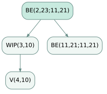

[全体の木](derivations/band_wip.md)

固定対 (i,j) と (u,v) が示すバンドの二本の腕をまとめる。外側の対を動かしつつ、内側の指定対に向かう。両目印が一致した基底の重みは 1。中央は別の部分に渡せる。

|規則|選んだ一回の展開に含まれる子の積|選択の意味|局所重み|
|---|---|---|---|
| `BE_BASE_SAMEPAIR` | $1$ | 外側の対と内側の対が一致。局所重み 1。 | $1$ |
| `BE_STACK` | $I(\mathrm{BE}(i+1,j-1,u*,v*))$ | 次の隣接した固定対へ進む。u*,v* は通常 u,v と等しい。展開関数には両目印一致時に両方を進める座標処理もある。 | バンド内のスタック因子 |
| `BE_INTERNAL_LOOP` | $I(\mathrm{BE}(k,l,u,v))$ | 次の固定対との間に内部ループを作る。 | バンド内の内部ループ因子 |
| `BE_WIP_WIP` | $I(\mathrm{WIP}(i+1,k-1))\,I(\mathrm{BE}(k,l,u,v))\,I(\mathrm{WIP}(l+1,j-1))$ | 左右に枝を持つ。 | $\mathrm{ap}\,\mathrm{bp}^{2}$ |
| `BE_WIP_BASEPAIR` | $I(\mathrm{WIP}(i+1,k-1))\,I(\mathrm{BE}(k,l,u,v))$ | 左に枝、右は未対合列。 | $\mathrm{cp}^{j-l-1}\,\mathrm{ap}\,\mathrm{bp}^{2}$ |
| `BE_BASEPAIR_WIP` | $I(\mathrm{BE}(k,l,u,v))\,I(\mathrm{WIP}(l+1,j-1))$ | 左は未対合列、右に枝。 | $\mathrm{cp}^{k-i-1}\,\mathrm{ap}\,\mathrm{bp}^{2}$ |

## WMBP が担当する部分

**座標例。** 50 塩基例の WMBP(1,44) は BE(16,35;19,32)、WMBW(1,26)、VP(27,44) を結ぶ。

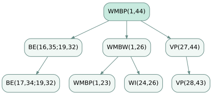

[全体の木](derivations/chain50.md)

交差するバンドが連なった鎖の途中。最初の交差対を置く、先頭の固定バンドと交差対を結ぶ、または前段で保留した固定バンドをつないで新しい VP を置く。保留とは、目印として参照した部分を後の規則が採点すること。

|規則|選んだ一回の展開に含まれる子の積|選択の意味|局所重み|
|---|---|---|---|
| `WMBP_SPLIT_BE_WMBP_VP` | `BE(p,q;l,m(l))` × `WMBP(i,k-1)` × `VP(k,j)` | 前の鎖と新しい VP が隙間を置かずにつながる。 | $\mathrm{PB}^{2}$ |
| `WMBP_SPLIT_BE_WMBW_VP` | `BE(p,q;l,m(l))` × `WMBW(i,k-1)` × `VP(k,j)` | 先に隙間を埋めた WMBW を経由してつなぐ。 | $\mathrm{PB}^{2}$ |
| `WMBP_DIRECT_VP` | $I(\mathrm{VP}(i,j))$ | 一つの交差部分から鎖を開始する。 | $\mathrm{PB}$ |
| `WMBP_SPLIT_BE_WI_VP` | `BE(i,m(i);k,l)` × `WI(k+1,p-1)` × `VP(p,j)` | 最初の固定バンドと新しい VP を結ぶ。BE の表示座標には下記の解決処理を適用する。 | $\mathrm{PB}^{2}$ |

## WMBW が担当する部分

**座標例。** 50 塩基例で WMBW(1,26) は WMBP(1,23) に WI(24,26) をつなぐ。

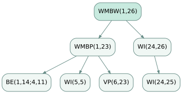

[全体の木](derivations/chain50.md)

前段の WMBP の右に非空の隙間 WI を足す。次の交差対と前の交差対の間に距離がある場合に、先に隙間を確定できる。

|規則|選んだ一回の展開に含まれる子の積|選択の意味|局所重み|
|---|---|---|---|
| `WMBW_SPLIT_WMBP_WI` | $I(\mathrm{WMBP}(i,k))\,I(\mathrm{WI}(k+1,j))$ | 部分鎖の右に非空の隙間を付ける。 | $1$ |

## WMB が担当する部分

**座標例。** 50 塩基例で WMB(1,50) は最後のバンド BE(37,50;40,47) を受け取り、鎖 WMBP(1,44) に残った仕事を完了させる。

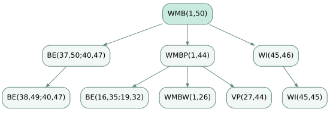

[全体の木](derivations/chain50.md)

完成した交差部分。鎖から直接完成する場合と、固定バンド・最後の隙間を付けて完成する場合を区別する。既定設定では足場に関する弱閉性（区間内と外を固定対が結ばないこと）を完成時に検査する。

|規則|選んだ一回の展開に含まれる子の積|選択の意味|局所重み|
|---|---|---|---|
| `WMB_SPLIT_BE_WMBP_WI` | $I(\mathrm{BE}(p,j,q,l))\,I(\mathrm{WMBP}(i,k))\,I(\mathrm{WI}(k+1,l-1))$ | 最終の固定バンド・隙間を引き受けて鎖を閉じる。 | $\mathrm{PB}$ |
| `WMB_DIRECT_WMBP` | $I(\mathrm{WMBP}(i,j))$ | 完成可能な鎖を同じ座標で受け取る。 | $1$ |
| `WMB_EMPTY` | $1$ | 候補の局所重みは 0。空の完成鎖を作らない。 | $0$ |

## 境界と重みの読み取り

$m(x)$ は位置 $x$ の固定対の相方を表す。WMBP の最初の固定バンドの BE は、外側を $(i,m(i))$ に固定して読む。共有バンドを過去の鎖から新しい VP へ渡す規則では、分割値 $k$ が新しい VP の始点、$l$ が内側の固定対の左端で、その右端は $m(l)$。したがって BE の四座標は $(p,q;l,m(l))$ である。表は一回の結合を示すので、並んだ子の区間が座標上で重なることがある。重なる文字を二重に採点するかは、各規則が実際に生成する対・未対合位置を調べて決まる。[共有バンドの条件](../../src/scfg2/deductions/README.md)

局所重みをいくつか具体化する。WI の末端未対合は擬似ループ中の未対合一個の費用 PUP を、外側 W が WMB を一つ受け取る規則は擬似ノット開始費用 PS を使う。BE の二本の腕を接着する規則と、一つのバンドとして鎖に置くときの開始費用 PB は別々の規則が持つ。多分岐にまたがる腕で、左だけに枝がある場合、右の未対合塩基数 $j-l-1$ に応じた費用が親に付く。右側にも WIP を要求すれば枝があることを意味し、別の選択になる。[局所重みの実装](../../src/scfg2/weights/README.md)

## 実際の木を読む四つの問題

以下の木は特定の出力に対して規則を選んだもの。構造指定なしに計算する分配関数では、ほかの許された木の重みも足す。リンク先には配列、足場、完成構造と各段階の子の位置が載る。

1. **左右の違い。** 20 塩基の一つ目の例では $VP(8,15)$ の CASE1 が $WI(9,10)$ を作る。別の 20 塩基例の $VP(6,13)$ の CASE2 は $WI(11,12)$ を作る。前者は最外の固定バンドから鎖を始める WMBP の結合、後者は VP から鎖を始めて最後に固定バンドを足す WMB の結合の内側にある。[CASE1](derivations/case1.md)・[CASE2](derivations/case2.md)
2. **枝のある腕。** 32 塩基例の $BE(2,23;11,21)$ は $WIP(3,10)$ と $BE(11,21;11,21)$ を作る。前者は未対合の 3 番と $V(4,10)$ に分かれ、その V は $V(5,9)$ の上にスタックする。$V(5,9)$ は 6～8 を囲むヘアピンになる。後者の BE の基底重みは 1。22 番という非空だが枝を持たない右の余白は、親の局所重みで受け取る。[32 塩基の全展開](derivations/band_wip.md)
3. **三つの隙間。** 50 塩基例の $VP(8,21)$ は CASE3 で $WI(9,10),WI(15,15),WI(20,20)$ を持つ。その規則が根の分配関数に与える寄与を知るには、三子の inside と規則の重みに、この VP への外側の値を掛ける。15 番の WI に返す際には、他の二つの WI の inside を掛ける。[50 塩基の全展開](derivations/chain50.md)
4. **保留を解く。** 同じ 50 塩基例の $WMBP(1,23)$ は固定バンド $BE(1,14;4,11)$、$WI(5,5)$、$VP(6,23)$ を持つ。次に $WMBW(1,26)$ で隙間を足す。$WMBP(1,44)$ は $BE(16,35;19,32)$ とこの WMBW、$VP(27,44)$ を結ぶ。最後に $WMB(1,50)$ が $BE(37,50;40,47)$ と $WMBP(1,44)$ と $WI(45,46)$ を結ぶ。16～19 を初段の VP が既に数えたものと扱うと、第二の BE の左腕と二重になる。[位置別の照合](README.md)

## 演習と解答

1. $WI(i,i)$ の重みを空の WI の値 1 に置き換えてよいか。**答**　単一塩基の規則は一個の未対合を数え、PUP に対応する局所重みを掛ける。親が長さゼロの隙間を省略する場合だけ空の積 1 を使う。
2. CASE3 の三つの子の inside が順に 2, 3, 5、局所重みが 4、親の outside が 7 とする。真ん中へ戻す感度は幾つか。**答**　$7\times4\times2\times5=280$。親の inside に足す重みは $4\times2\times3\times5=120$。
3. $BE(2,23;11,21)$ の例で、右側が未対合一個なら右 WIP の長さを一とした別解を足せるか。**答**　WIP には枝が要る。その一塩基は親の未対合費用で数え済みであり、もう一つの選択は加えない。
4. 一つの状態を二種類の親が使うとき、どちらの親の outside を使うか。**答**　それぞれが使う規則と兄弟の値を掛けてから、両方の寄与を足す。一つの親を選んだ導出木と、すべての規則を足す計算を区別する。
