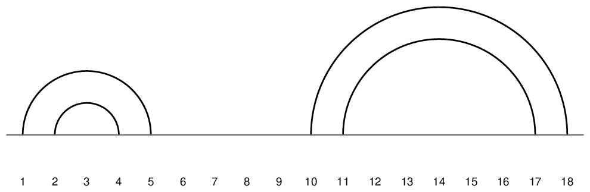
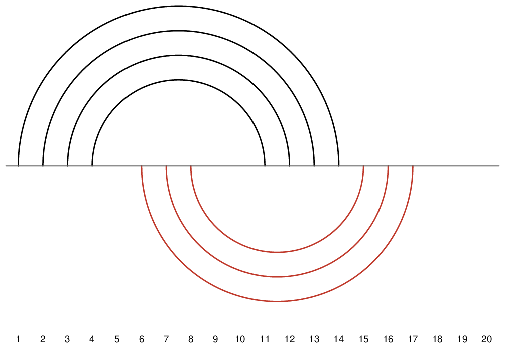
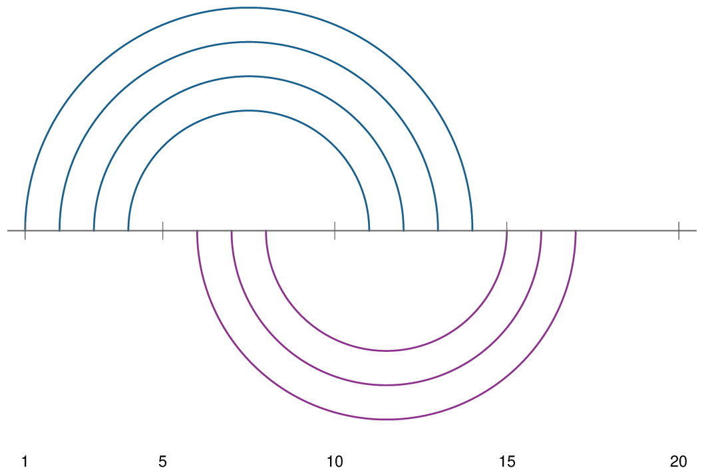
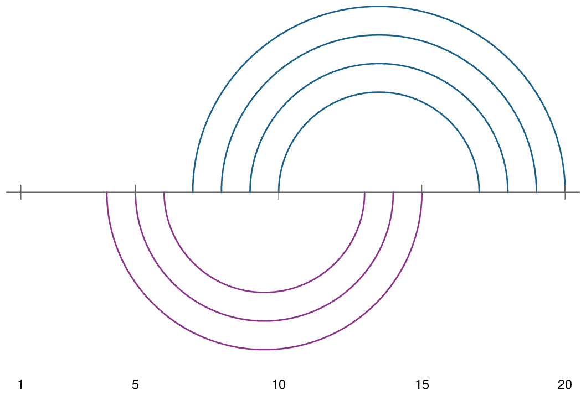
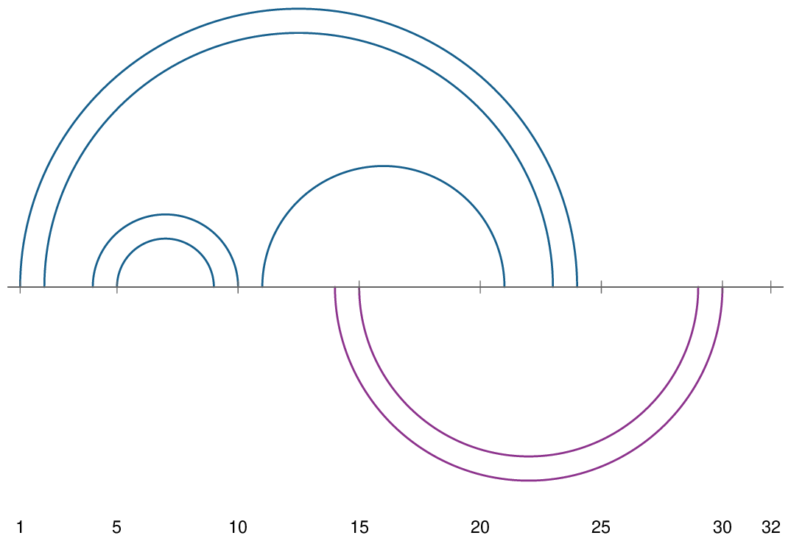
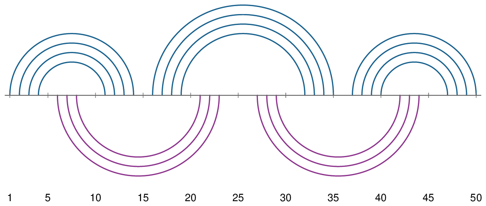

# 一本の弧からバンドの計算まで

図は LinearKnot 教科書第1章・第4章の弧図を再掲したものです。配列を左から右へ読み、位置は1から数えます。弧を一本選び、その両端の位置を読むと一つの塩基対になります。弧の高さは塩基対のエネルギーや確率を表しません。

## 18塩基で入れ子を読む（第1章）

固定する対の集合を $G$ とします。対 $(1,5)$ の内側には $(2,4)$ があり、位置3は両方の内側にあります。これが入れ子です。$(1,5)$ と右側の $(10,18)$ は配列上で離れています。この図は位置関係を教えるための例です。$(2,4)$ の内側は一塩基だけなので、通常のヘアピンの分配関数を評価する数値例には用いません。

## 20塩基で「交差」と「バンド」を読む（第1章）

赤を追加する対の集合 $G'$、完成構造を $R=G\cup G'$ とします。固定対 $(1,14)$ と追加対 $(6,17)$ の端を左から読むと $1<6<14<17$。端が交互に現れるので、この二対は交差します。$(1,14)$ と $(2,13)$ は $1<2<13<14$。端が入れ子なので互いには交差しませんが、どちらも $(6,17)$ と交差しています。

**バンドをどう決めるか。** 交差に参加する塩基対を二本選び、外側を $(a,q)$、内側を $(c,s)$ とします。$a\leq c<s\leq q$ のとき、左の隙間 $[a+1,c-1]$ と右の隙間 $[s+1,q-1]$ を調べます。区間内の各位置が未対合か、相手も区間内にあれば、その区間は完成構造 $R$ に関して**弱閉**です。両方の隙間が弱閉なら、内側の対は外側の対に *directly banded in* されます。この関係で比較できる交差対を入れ子に並べ、さらに対を加えて延長できない列が**バンド**です。図の固定対側では $(1,14),(2,13),(3,12),(4,11)$ がその一例です。

**構造から計算へ。** 外側が $(1,14)$、内側が $(4,11)$ なら、二本の腕は $[1,4]$ と $[11,14]$ です。状態 $\mathrm{BE}(1,14;4,11)$ はこの腕をたどります。穴 $[5,10]$ のうち5番は WI に、6～10番は VP 側に渡ります。この導出で三つの子が担当する位置を並べてみましょう。

| 子 | この導出で数える位置 |
|---|---|
| $\mathrm{BE}(1,14;4,11)$ | $[1,4]\cup[11,14]$ |
| $\mathrm{WI}(5,5)$ | $\{5\}$ |
| $\mathrm{VP}(6,17)$ | $[6,10]\cup[15,17]$ |

上の集合を合わせると、1から17までが一度ずつ現れます。文法は、バンド全体を外側から作る途中で、その一部にも同じ BE の形式を使います。[この例の導出木](../derivations/case1.md)

## 交差対の左右を入れ替える（第4章）

上の図では青が固定対、紫が追加対です。上下に分けた図でも、端の並びから交差を判定します。紫の一番内側の対 $(8,15)$ から中心へ進むと、9・10番が左側の隙間にあります。11～14番は青い腕の担当です。この VP の規則は $\mathrm{WI}(9,10)$ を子に持ちます。

こちらの紫の一番内側の対は $(6,13)$。今度は11・12番が右側の隙間です。図からこの違いを読んでから、二つの導出で WI の座標を比べられます。[CASE1 の木](../derivations/case1.md)・[CASE2 の木](../derivations/case2.md)

## 32塩基で「腕の途中に枝がある」を読む（第4章）

固定バンドを $(1,24)\supset(2,23)\supset(11,21)$ とたどります。$(2,23)$ から $(11,21)$ に進むとき、左の隙間 $[3,10]$ には $(4,10),(5,9)$ という閉じた枝が入ります。右は22番一個だけです。左の全8塩基を未対合として一律に課金すれば、図にある枝を見失います。この規則は枝を含む左の部分を $\mathrm{WIP}(3,10)$ に渡し、右の未対合一個を親で数えます。[この例の導出木](../derivations/band_wip.md)

## 50塩基で「保留」を読む（第4章）

青を左から $A,B_2,C$、紫を左から $P_1,P_2$ と呼びます。交差する相手を順にたどると $A-P_1-B_2-P_2-C$ です。例えば $P_1$ の対 $(6,23)$ は $A$ の $(1,14)$ とも $B_2$ の $(16,35)$ とも交差します。途中の $\mathrm{WMBP}(1,23)$ では $B_2$ の存在は足場から分かっていますが、その腕の重みは後段に保留します。後で $\mathrm{BE}(16,35;19,32)$ がこの腕を引き受けます。完成構造にある対を示す弧と、ある段階でそのエネルギーを数える規則をこうして対応づけられます。[50塩基の全導出](../derivations/chain50.md)

原図は教科書の `01_prelim_arc18`、`01_prelim_arc20`、`04_arc_case1`、`04_arc_case2`、`04_arc_band_wip`、`04_arc_chain50`。第1章の20塩基図と第4章の CASE1 は同じ対を異なる表示で描いています。
