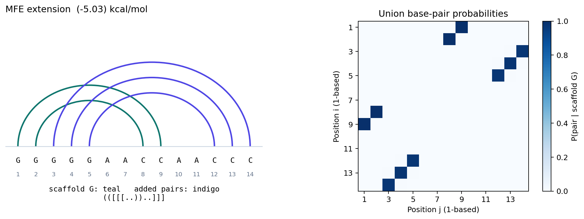
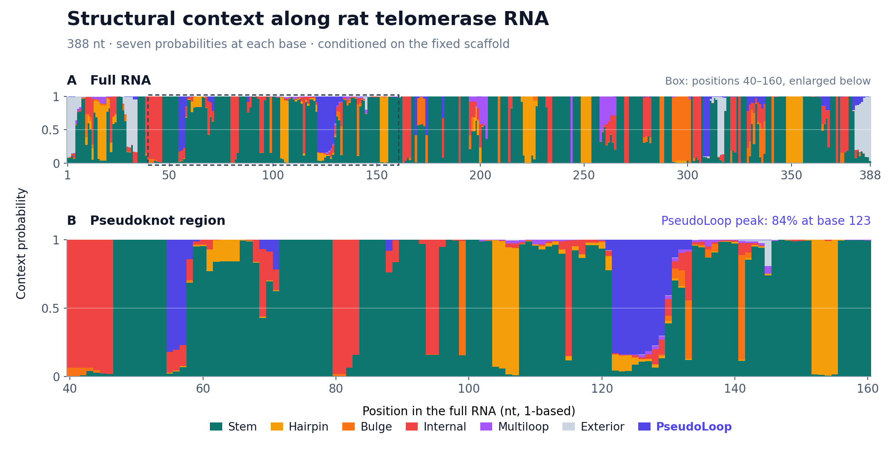
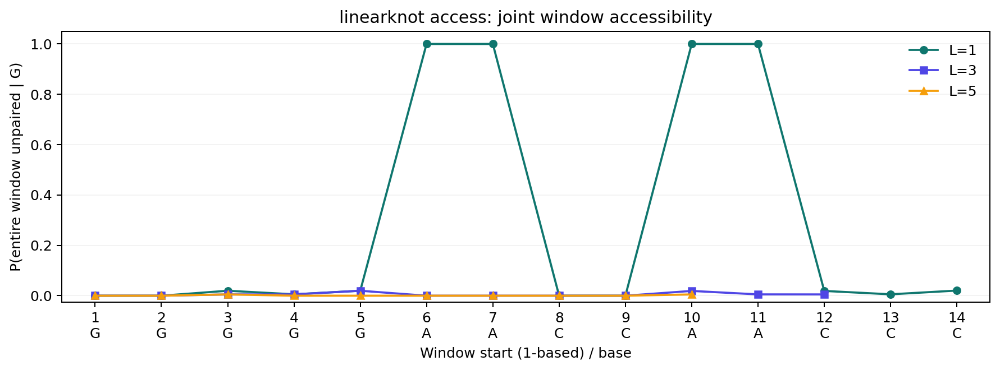
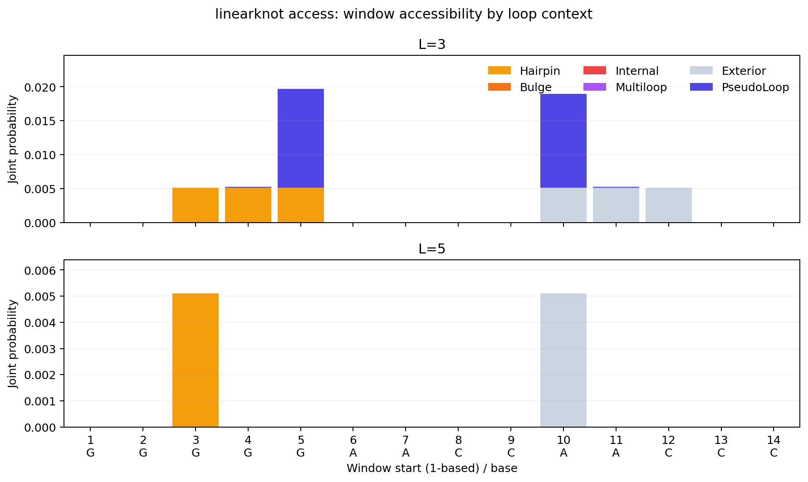
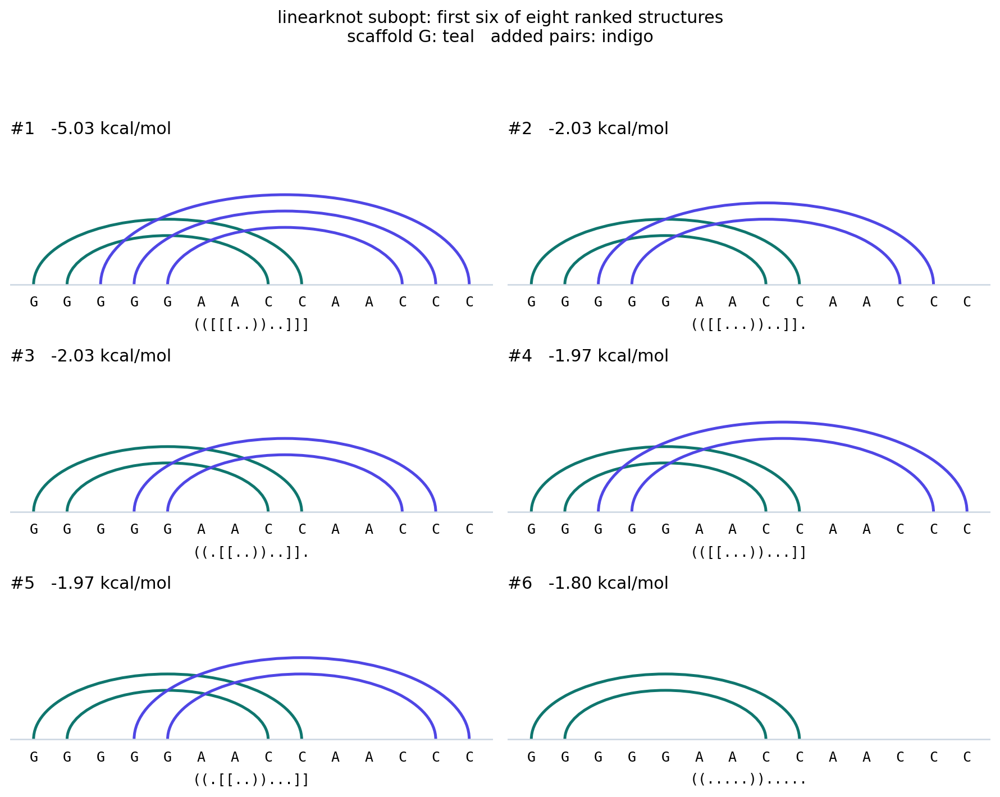

# Inputs, outputs, and figures

The [hairpin/exterior example](hairpin_exterior/input.txt) uses one small
synthetic RNA to show predictions and ensemble analyses from LinearKnot. The
sequence is illustrative, not an experimentally validated RNA or a
benchmark of beam approximation quality.

```text
>hairpin_exterior
GGGGGAACCAACCC
((.....)).....
```

Both beam and exact prediction produce `(([[[..))..]]]`. The added pairs
`(3,14)`, `(4,13)`, and `(5,12)` connect the scaffold hairpin to the exterior
and cross the fixed scaffold pairs `(1,9)` and `(2,8)`. Positions here are
one-based. The synthetic example uses beam 100, outer ranking, pilot exponent
2/3, local caps 30, and the bundled Turner2004 parameters. The
[rat Terc profile](terc_profile/README.md) below uses a longer biological
sequence and beam/local caps 200.

## Prediction and base-pair probabilities

The `linearknot fold --bpp FILE` option writes union pair probabilities,
including fixed scaffold pairs with
probability one. Each data row is `i j probability`, with one-based
positions and `i < j`.

```bash
linearknot fold -i examples/hairpin_exterior/input.txt --beam 100 --bpp bpp.tsv
```

[Prediction](hairpin_exterior/output/prediction.txt) ·
[BPP table](hairpin_exterior/output/bpp.tsv) ·
[Vector figure](hairpin_exterior/figures/bpp.svg)



## Structural contexts: linearknot profile

The README's profile figure uses rat telomerase RNA (388 nt). Its full-length
overview and enlarged pseudoknot region show all seven structural contexts.

```bash
linearknot profile -i examples/terc_profile/input.txt \
  --beam 200 --max-hairpin 200 --max-case3-depth 200
```

[Output](terc_profile/output/loop_profile.txt) ·
[Vector figure](terc_profile/figures/loop_profile.svg) ·
[Input and reproduction](terc_profile/README.md)

Each labeled row contains one probability per base. The seven contexts are
Stem, Hairpin, Bulge, Internal, Multiloop, Exterior, and PseudoLoop. Their
probabilities sum to one at each base. The extra PseudoLoop context makes
the pseudoknot contribution visible in this example.



The [14-nt synthetic profile](hairpin_exterior/output/loop_profile.txt) remains
available alongside the other outputs from the small example.

## Window accessibility: linearknot access

```bash
linearknot access -i examples/hairpin_exterior/input.txt --access-len 1,3,5 --probability
linearknot access -i examples/hairpin_exterior/input.txt --access-len 1,3,5
linearknot access -i examples/hairpin_exterior/input.txt --access-len 1,3,5 --probability --by-loop
```

[Probabilities](hairpin_exterior/output/raccess_probability.txt) ·
[Opening energies](hairpin_exterior/output/raccess_energy.txt) ·
[Loop probabilities](hairpin_exterior/output/raccess_byloop.txt) ·
[Loop figure](hairpin_exterior/figures/raccess_byloop.svg) ·
[Vector figure](hairpin_exterior/figures/raccess.svg)

The first column of the raw output is a **zero-based** window start;
`L,value;` entries give the requested lengths. The figure converts starts
to one-based positions. Windows extending past the sequence end are
omitted. `--probability` returns the joint probability that the entire
window is unpaired, not a product of single-base probabilities. The
default output is the opening energy `ED = -RT log P` in kcal/mol;
`P = 0` is reported as `inf`.

`--by-loop` appends a third column such as
`byloop:3,E=...,H=...,B=...,I=...,M=...,P=...;` for each valid length.
The codes stand for Exterior, Hairpin, Bulge, Internal, Multi, and
PseudoLoop. Each value is the joint probability that the entire window is
unpaired in that context; their sum equals the window's total accessibility.
At length one these values equal the corresponding loop-profile probabilities.
The loop column always contains probabilities, even when the total column
contains opening energies. The existing first two columns are preserved.





## Ensemble sampling: linearknot sample

```bash
linearknot sample -i examples/hairpin_exterior/input.txt --count 20 --seed 42
linearknot sample -i examples/hairpin_exterior/input.txt --count 1000 --seed 42 --unique
```

[Twenty draws](hairpin_exterior/output/samples.txt) ·
[Counts from 1,000 draws](hairpin_exterior/output/sample_counts.txt)

Sampling draws structures according to their Boltzmann probabilities in the
retained beam ensemble. Repeated structures are expected. `--unique` groups
the draws and prints `count<TAB>structure`, most frequent first. For this
example, the saved grouped output is:

```text
>hairpin_exterior
GGGGGAACCAACCC
968	(([[[..))..]]]
9	((.[[..))..]].
8	((.[[..))...]]
8	(([[...))...]]
5	(([[...))..]].
1	((.....)).....
1	((.[...))..]..
```

The counts sum to 1,000; dividing by 1,000 gives empirical frequencies.
This is a sample, rather than an exhaustive list or an energy ranking.
`--seed` repeats a run with the same settings. Use `--exact` to sample from
the full fixed-scaffold ensemble instead of the retained beam ensemble.

## Ranked structures: linearknot subopt

```bash
linearknot subopt -i examples/hairpin_exterior/input.txt --beam 100 --top-k 8 --stats
```

[Eight structures](hairpin_exterior/output/subopt.txt) ·
[Enumeration statistics](hairpin_exterior/output/subopt_stats.txt) ·
[Vector figure](hairpin_exterior/figures/subopt.svg)

The figure shows the first six results; the text contains all eight.
Energies are in nondecreasing order, and ties are possible. In beam mode
these ranks apply to the inside-retained forest. To enumerate the full
fixed-scaffold grammar, use `--exact` instead of beam/ranking options.
Teal arcs are the fixed scaffold; indigo arcs are added pairs.



## Representative structures: linearknot mea and centroid

```bash
linearknot mea -i examples/hairpin_exterior/input.txt --gamma 1
linearknot centroid -i examples/hairpin_exterior/input.txt --gamma 1
```

[MEA prediction](hairpin_exterior/output/mea.txt) ·
[Gamma-centroid prediction](hairpin_exterior/output/centroid.txt)

These commands each return one structure optimized from ensemble
base-pair probabilities under their respective objective. `--gamma`
controls the reward for predicting pairs. Both predict `(([[[..))..]]]`
in this example with gamma 1.

## Reproduce the gallery

To regenerate the synthetic hairpin/exterior example, run from the repository
root with the CLI program installed on PATH. The longer
[Terc profile has separate reproduction steps](terc_profile/README.md#reproduce).

```bash
python3 examples/run.py
python3 -m pip install -r examples/requirements.txt
python3 examples/plot.py --data-dir build/examples/hairpin_exterior/output
```

If using a native build, run `python3 examples/run.py --bin-dir build`.
To plot the checked-in outputs without running the tools, use
`python3 examples/plot.py`. Matplotlib is only needed to regenerate the
figures; using the CLI programs and viewing the saved outputs needs no
plotting dependencies. PNG and SVG files are generated under `build/examples/`.

To refresh the checked-in gallery explicitly:

```bash
python3 examples/run.py --bin-dir build --output-dir examples/hairpin_exterior/output
python3 examples/plot.py --output-dir examples/hairpin_exterior/figures
```

`run.json` records commands, parameter settings, and binary hashes.
Timing metadata and last-digit floating-point differences may vary between
runs. The plotter checks probability normalization, agreement between the
loop profile's Stem row and BPP, single-base accessibility/BPP agreement,
the opening-energy conversion, and the suboptimal energy ordering before
finishing.
