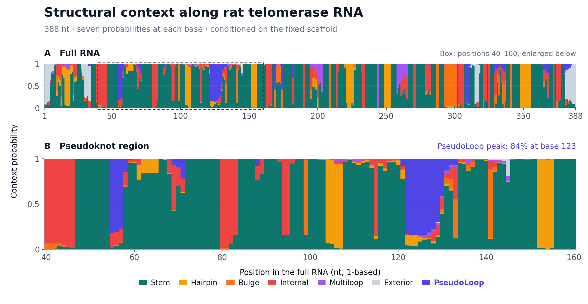

# Rat telomerase RNA: structural-context profile

This example uses the 388-nt rat Terc input from the paper's telomerase RNA
example: bpRNA_RFAM_4317, RefSeq
[NR_001567.1](https://www.ncbi.nlm.nih.gov/nuccore/NR_001567.1), RNAcentral
URS00001ED027. The [input](input.txt) preserves 61 canonical nested pairs
from the bpRNA reference as its scaffold G. The input was copied unchanged;
the probabilities were recomputed with the current LinearKnot CLI.

[Raw profile](output/loop_profile.txt) · [Run manifest](output/run.json) ·
[SVG](figures/loop_profile.svg)



The upper panel shows all 388 positions. The lower panel enlarges positions
40–160, around the reference pseudoknot. Both panels use the same full-length
calculation and retain coordinates in the full RNA. Each column partitions
probability among Stem, Hairpin, Bulge, Internal, Multiloop, Exterior, and
PseudoLoop. PseudoLoop reaches 0.839701 at base 123 within the enlarged region.

These probabilities describe the model ensemble conditional on this scaffold.
The calculation uses beam 200, outer ranking, pilot exponent 2/3, hairpin and
CASE3-depth limits 200, bundled Turner2004 parameters, and the default
completed-WMB weak-closure policy. These limits are explicit; the CLI's
geometry defaults remain 30.

## Reproduce

From the repository root, with `linearknot` on PATH:

```bash
python3 examples/terc_profile/run.py
python3 examples/terc_profile/plot.py --data-dir build/examples/terc_profile/output
```

For a native build, add `--bin-dir build` to the first command. The runner
records the command, input/output hashes and executable hash in `run.json`.
It runs outside the source directory with the bundled parameters.
The saved text omits the CLI's trailing blank record separator.
Last-digit numerical differences may occur across builds.

The equivalent folding command is:

```bash
linearknot profile -i examples/terc_profile/input.txt \
  --beam 200 --ranking outer --outer-pilot-exponent 2/3 \
  --max-hairpin 200 --max-case3-depth 200 > loop_profile.txt
```

To redraw the checked-in data without running the RNA calculation:

```bash
python3 examples/terc_profile/plot.py
```

Plotting requires the packages in [requirements.txt](../requirements.txt).
PNG and SVG files are written under `build/examples/terc_profile/figures`.
The plotter checks the saved hashes, all probability ranges, normalization
at every position, and Stem probability one at fixed scaffold bases. Colors
match the other example figures; no smoothing or aggregation is applied.

To refresh the checked-in outputs and figures explicitly:

```bash
python3 examples/terc_profile/run.py --output-dir examples/terc_profile/output
python3 examples/terc_profile/plot.py --output-dir examples/terc_profile/figures
```
